<a id="readme-top"></a>

<div align="center">

<a href="https://github.com/shajeduzzamanenan992008inc/Telegram-Bot">
  
</a>

<h1>Enan Ultra &middot; Telegram AI Assistant</h1>

<p>
  <b>Lightning-fast &nbsp;&middot;&nbsp; Privacy-first &nbsp;&middot;&nbsp; Provider-agnostic</b><br>
  A modular, async Telegram AI assistant with multi-provider failover, encrypted personal knowledge,<br>
  human-approved automation and a hardened Ubuntu/systemd deployment path.
</p>

<p><sub><i>Fast. Smart. Secure.</i></sub></p>

<a href="https://t.me/YOUR_BOT_USERNAME">
  
</a>

<p>
  <a href="#overview"><b>Overview</b></a> &nbsp;&middot;&nbsp;
  <a href="#highlights">Highlights</a> &nbsp;&middot;&nbsp;
  <a href="#architecture">Architecture</a> &nbsp;&middot;&nbsp;
  <a href="#quick-start">Quick Start</a> &nbsp;&middot;&nbsp;
  <a href="#command-reference">Commands</a> &nbsp;&middot;&nbsp;
  <a href="#security-and-privacy">Security</a> &nbsp;&middot;&nbsp;
  <a href="#deployment">Deployment</a> &nbsp;&middot;&nbsp;
  <a href="#documentation-map">Docs</a> &nbsp;&middot;&nbsp;
  <a href="#brand-and-asset-library">Brand Kit</a> &nbsp;&middot;&nbsp;
  <a href="#license">License</a>
</p>

[](#quick-start)
[](https://core.telegram.org/bots/api)
[](#quality-and-ci)
[](#security-and-privacy)


[](https://github.com/shajeduzzamanenan992008inc/Telegram-Bot/stargazers)
[](https://github.com/shajeduzzamanenan992008inc/Telegram-Bot/network/members)
[](https://github.com/shajeduzzamanenan992008inc/Telegram-Bot/issues)
[](https://github.com/shajeduzzamanenan992008inc/Telegram-Bot/commits/main)

<br>

<a href="assets/12-creator/creator-credit-wide.svg"></a>

</div>

<br>

<details>
<summary><b>Table of contents</b></summary>

- [Overview](#overview)
  - [Design principles](#design-principles)
- [Highlights](#highlights)
- [Feature Catalog](#feature-catalog)
- [Architecture](#architecture)
- [Quick Start](#quick-start)
- [Configuration](#configuration)
- [Command Reference](#command-reference)
- [Mission Control Dashboard](#mission-control-dashboard)
- [Security and Privacy](#security-and-privacy)
- [Deployment](#deployment)
- [Backup and Restore](#backup-and-restore)
- [Quality and CI](#quality-and-ci)
- [Documentation Map](#documentation-map)
- [Brand and Asset Library](#brand-and-asset-library)
- [Support](#support)
- [License](#license)
- [Credits](#credits)

</details>

<details>
<summary><b>English Summary</b></summary>

<br>

**Enan Ultra** is a modular, asynchronous Telegram AI assistant. Bangla is the bot’s default response language, but it can respond in multiple languages.

- **AI providers:** OpenRouter, Groq, Gemini, Cloudflare Workers AI, and Hugging Face. If one provider fails, the router moves to the next eligible provider in the configured order.
- **Identity:** The bot identifies itself as an AI and does not impersonate a human.
- **Privacy:** Local-only mode (Ollama only), opt-in memory, an encrypted Personal Knowledge Base, and encrypted backups.
- **Controls:** Per-user daily and monthly request and cost limits; administrator approval for state-changing actions.
- **Quick start:** Run `python scripts/init_env.py`, configure `.env`, run `uv sync --locked --group build --group test`, then start the bot with `uv run enan-ultra`.
- **More information:** See the [Documentation Map](#documentation-map).

</details>

<p align="center"></p>

<p align="center"></p>

<h2 align="center">Overview</h2>

<p align="center"><i>An assistant you can reason about: every capability is bounded, every sensitive action is gated, every limitation is documented.</i></p>


**Enan Ultra** is a modular, asynchronous Telegram AI assistant written in Python. It routes every request through the AI providers *you* configure (OpenRouter, Groq, Gemini, Cloudflare Workers AI and Hugging Face, plus an optional local-only mode on Ollama) and wraps them in the controls a real deployment needs: per-user cost and rate limits, encrypted storage, consent-first memory, malware-scanned uploads, human approval for anything that changes state, and a loopback-only operations dashboard.

Bangla is the default conversation language and the assistant replies in many others. It understands images, documents, audio and video, cites its web research, works in private chats and groups, offers inline sticker search, and ships an optional Telegram Mini App with an adaptive theme engine.

> [!IMPORTANT]
> **Transparent identity.** Enan Ultra always introduces itself as an AI and never poses as a human. *GPT-6 Astra* is only a conversational **style profile**; it says nothing about which model is actually running. The real model is whichever provider and model you configured.

<table>
<tr>
<td width="33%" valign="top">

**⚡ Fast**

Async end to end. Private chats get Bot API Rich Message live previews, a native *Thinking* placeholder, streamed text and, on supported clients, a Stop button. Round-robin keys and ordered provider failover keep answers flowing when a key or provider misbehaves.

</td>
<td width="33%" valign="top">

**🧠 Smart**

Multimodal understanding (images, documents, audio, video), OCR, QR/barcode reading, cited web research, budget-limited specialist review for hard research, code and security questions, and Bangla-first multilingual replies.

</td>
<td width="33%" valign="top">

**🛡 Secure**

Local-only privacy mode, opt-in memory, encrypted knowledge base and backups, ClamAV-scanned uploads that fail closed, hash-pinned approvals, rootless network-less sandboxes, and no arbitrary-shell endpoint in the dashboard, VM controls or missions.

</td>
</tr>
</table>

### Design principles

1. **Transparent identity.** An AI that says it is an AI.
2. **Consent before persistence.** Memory is opt-in. The Personal Knowledge Base stores only what a user explicitly saves with `/kb save`. Background learning never silently opts anyone in.
3. **Bounded by default.** Budget-limited agents, per-user daily and monthly caps, capped group history windows, size and pixel limits, and time-boxed retention.
4. **Human in the loop.** Restarts, Home Assistant actions, patch tests and self-improvement proposals need explicit approval. Specialist agents advise; they never execute Telegram, Home Assistant or VM actions.
5. **Honest about limits.** Unsupported formats are never claimed as read. Theme detection is deterministic keyword matching and can misfire on typo-heavy or ambiguous input. JSON mode is prompt guidance, not a schema validator. Sticker emoji are category hints, not guarantees of meaning.

<p align="center"></p>

<p align="center"></p>

<h2 align="center">Highlights</h2>

<p align="center"><i>What you get out of the box.</i></p>


| **5 + 1** | **10** | **7** | **3.11 – 3.15** | **24 h** | **0** |
|:---:|:---:|:---:|:---:|:---:|:---:|
| cloud AI providers + local Ollama | translation languages | persona styles | supported Python versions (CI matrix) | encrypted snapshot cadence, last 7 kept | arbitrary-shell endpoints in the dashboard |

<table>
<tr>
<td width="33%" valign="top" align="center">
<br>
<b>Multi-provider AI router</b><br>
<sub>OpenRouter → Groq → Gemini → Cloudflare → Hugging Face with key rotation, key quarantine and cooldown-aware failover.</sub>
</td>
<td width="33%" valign="top" align="center">
<br>
<b>Privacy modes</b><br>
<sub>Cloud or local-only (Ollama). Opt-in memory, <code>/temporary</code> chats, one-command <code>/privacy export</code> and <code>/privacy delete confirm</code>.</sub>
</td>
<td width="33%" valign="top" align="center">
<br>
<b>Encrypted by design</b><br>
<sub>Personal KB and database backups use a Fernet key derived from <code>APP_DATA_KEY</code>. WAL SQLite with versioned migrations.</sub>
</td>
</tr>
<tr>
<td valign="top" align="center">
<br>
<b>Cited web research</b><br>
<sub><code>/search</code>, <code>/research</code> and <code>/read</code> return source URLs. <code>/historysearch</code> searches your saved chat locally.</sub>
</td>
<td valign="top" align="center">
<br>
<b>Bangla-first, multilingual</b><br>
<sub>Bangla by default, <code>/translate</code> into 10 languages, English, Bangla and selected Roman Bangla topic detection.</sub>
</td>
<td valign="top" align="center">
<br>
<b>Study Mode</b><br>
<sub>Private flashcards, simple spaced review and AI-generated multiple-choice questions as native Telegram Quiz Polls.</sub>
</td>
</tr>
<tr>
<td valign="top" align="center">
<br>
<b>Reminders and tasks</b><br>
<sub>Timezone-aware one-time, relative, daily and weekly reminders with snooze and bounded retries. Tasks with priority, deadline and prerequisites.</sub>
</td>
<td valign="top" align="center">
<br>
<b>Rich Telegram experience</b><br>
<sub>Rich Message live preview, streaming, Stop button, adaptive-theme Mini App, inline sticker search and <code>/make_sticker</code>.</sub>
</td>
<td valign="top" align="center">
<br>
<b>Specialist agents and missions</b><br>
<sub>Bounded, read-only analysis with encrypted mission storage. No arbitrary tools, no shell, no deployment.</sub>
</td>
</tr>
<tr>
<td valign="top" align="center">
<br>
<b>Sandboxed code review</b><br>
<sub><code>/patch</code> and <code>/test</code> run in rootless, network-less, disposable containers. Patches are never applied to live code.</sub>
</td>
<td valign="top" align="center">
<br>
<b>Human-approved operations</b><br>
<sub>Approvals for Home Assistant, restarts and self-improvement proposals, pinned to a patch SHA-256.</sub>
</td>
<td valign="top" align="center">
<br>
<b>Cost and rate control</b><br>
<sub>Per-user daily and monthly request and cost caps, free-tier-only mode and a live <code>/usage</code> view.</sub>
</td>
</tr>
</table>


<p align="center"></p>

<p align="center"></p>

<h2 align="center">Feature Catalog</h2>

<p align="center"><i>Everything the assistant does, grouped by what you are trying to accomplish.</i></p>


### AI core and providers

- **Five cloud providers behind one contract.** OpenRouter, Groq, Gemini, Cloudflare Workers AI and the Hugging Face Inference API are routed by `services/providers.py`.
- **Ordered failover.** The default order is **OpenRouter → Groq → Gemini → Cloudflare → Hugging Face**; change it with `AI_PROVIDER_ORDER`. With `DEFAULT_AI_MODEL=auto` the first suitable model in that order is used, `FALLBACK_MODELS` adds model-level fallback, `/models` lists models, and an admin switches with `/model provider::model-id`.
- **Key rotation done right.** Comma-separated keys start round-robin. A `401` quarantines the rejected key and the next key is tried. Account or project quota, `402` and `429` responses never trigger sibling-key attempts; the cooldown is respected instead. If every provider fails, the bot answers with a clear, generic retry-later message.
- **Local-only privacy mode.** No cloud fallback at all. Text and images go only to your configured local Ollama.
- **Free-tier first.** `AI_FREE_ONLY=true` keeps cloud models off unless they are on an exact `provider::model-id` allowlist. Paid fallback needs both `AI_ALLOW_PAID_FALLBACK=true` and a positive `AI_MAX_ESTIMATED_COST_USD`.
- **Diagnostics.** `/providerdiag` shows local circuit and key health; `/providerdiag recheck <provider>` lets an admin run a provider health check and reset quarantine. Provider API keys are never shown in the dashboard, the API or logs.
- **Legacy credentials retired.** OpenAI, Anthropic, Together AI and SambaNova credentials are no longer used for cloud routing.

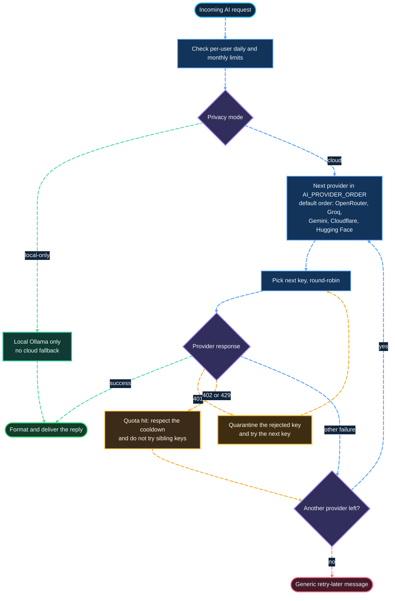

### Multimodal understanding and documents

- **Vision.** Photos use the highest-resolution Telegram variant and are sent as an image-modality request to the configured vision-capable provider. `VISION_MODEL` selects the OpenRouter model (default `google/gemini-2.5-flash:free`) when OpenRouter is available. Image byte limits and `MAX_IMAGE_PIXELS` apply.
- **Documents, audio and video.** Supported formats flow through file adapters (`files/registry.py`), OCR, QR/barcode reading and source locators. Scanned-PDF OCR renders pages at no more than 2048 px. An unsupported format is never claimed as successfully read.
- **Generation and voice.** `/image` and `/imagine` use OpenRouter's image-models API. `IMAGE_MODEL` must be an ID from OpenRouter's current image-model catalog, otherwise an available image model is used. `/voice on` enables voice replies (the confirmation is a voice note too): OpenRouter TTS is tried first when `TTS_MODEL` is configured, otherwise, or on failure, gTTS is used, which sends the text to Google's external TTS service. Generated MP3 temp files are removed after sending.
- **Cloud requirements.** Web search, remote file fallback, transcription and image generation need OpenRouter.

### Memory, knowledge and privacy controls

- **Opt-in memory.** `/memory on` enables asynchronous extraction of explicit profile facts and learned knowledge, from private messages only. `/memory learn off` stops extraction but keeps stored memory; `/memory off` disables both. After a successful text reply the conversation pair is sent asynchronously to the configured OpenRouter model. Personal facts stay user-scoped; only explicitly general, non-sensitive knowledge may be shared, and then as untrusted context. Learning is skipped in temporary chats, in local-only mode and for image messages. Existing memory preferences never silently opt anyone in.
- **Forgetting.** `/forget all`, `/clear`, `/reset` and account deletion remove a user's learned facts and any general facts they contributed.
- **Personal Knowledge Base.** Encrypted and user-isolated. Content persists only when the user consents with `/kb save`. Per-user document and size caps apply, and the temporary file index expires on schedule.
- **Temporary mode.** `/temporary on` runs the next private AI conversations without history, memory, document or personal-KB retrieval; `/temporary off` restores normal persistence. Retention limits for temporarily uploaded documents apply separately.
- **Your data, your call.** `/privacy export` returns user-owned stored data, including the stored profile and learned facts, as JSON. `/privacy delete confirm` removes user-linked account data. Private-chat history and documents are exported and deleted; shared group history is left alone to protect the other members.

### Productivity: study, reminders, tasks and exports

- **Study Mode.** `/study card add question :: answer`, `/study due`, `/study review ID good|again` and `/study cards` give you private flashcards with simple spaced-review intervals (private chat only). `/study quiz topic` sends an AI-generated multiple-choice question as a native interactive Quiz Poll.
- **Reminders.** `/timezone Asia/Dhaka` validates and stores an IANA timezone. `/remind YYYY-MM-DD HH:MM message` sets a one-time reminder in that timezone's local time; relative (`/remind 10m message`) and `daily` / `weekly` recurrence are supported. `/reminders` lists in local time, with `pause ID` and `resume ID`; `/snooze ID 10m` postpones a pending reminder. Delivery uses an atomic claim and bounded exponential retry.
- **Tasks.** `/tasks add priority=high due=2026-12-31 after=ID text` adds a priority, an optional ISO-date deadline and a prerequisite; a task cannot be completed before its prerequisite. `/tasks plan <goal|chat>` builds up to 10 private tasks with dependencies from a budget-limited, privacy-aware AI request (`chat` uses recent, bounded private history and is never used in temporary chats). Replying to a message with `/tasks add` turns its text or caption into a task.
- **Translate, persona, format, style.** `/translate bn|en|ar|hi|ur|es|fr|de|ja|zh text` follows your privacy mode and usage limits. `/persona default|expert|creative|research|tutor|professional|debate` changes answer style, and `/persona custom instructions` stores up to 500 characters that always rank below system and safety rules. `/format text|markdown|json` sets the preferred answer structure (JSON mode is prompt guidance, not a strict schema validator). `/setmode default|sarcastic|anime|professional|regional` sets a per-chat response style.
- **Exports.** `/export md|txt|pdf` exports saved private-chat history and `/export file ID md|txt` exports extracted text from a retained private-chat document index. For Bangla PDF shaping, the Ubuntu installer adds `fonts-noto-core`; Windows uses Nirmala UI.
- **Usage and budgets.** `/usage` shows daily and monthly consumption against the per-user daily request limit plus `USER_MONTHLY_REQUEST_LIMIT` and `USER_MONTHLY_COST_LIMIT_USD`.

### Telegram-native experience

- **Rich Messages.** AI answers and admin support replies share one formatter. In private chats you get a Bot API Rich Message live preview, a native *Thinking* placeholder, streamed text and, on supported clients, a Stop button; the final answer is sent as a permanent rich message. If the Rich API is unavailable, a plain message draft or text fallback takes over. `/cancel` stops the active provider request and keeps any text generated so far.
- **Adaptive Living Theme Engine.** Topic detection in English, Bangla and selected Roman Bangla; persistent per-user theme, motion and appearance settings; manual `/theme` controls; and an optional Telegram Mini App with streaming chat (`/app`). It is deterministic keyword and context matching, so typo-heavy or ambiguous input can be misjudged. The Mini App needs an HTTPS domain, a reverse proxy and signed Telegram identity validation; see [`docs/MINI_APP.md`](docs/MINI_APP.md).
- **Inline sticker search and creation.** After you enable inline mode in BotFather, `@BOT_USERNAME <keyword>` returns up to 20 matches, from approved sticker metadata only. Automatic sticker use also honours user preference, intent or category, and a cooldown. `/make_sticker` creates a static WebP sticker from a photo caption or from a reply to a photo.
- **Voice and media preferences.** `/voice` and `/media` give users control over voice replies and media behaviour.

### Sticker catalog

- **One database.** The catalog lives in the main async SQLite database and is included in the scheduled encrypted backups. A legacy `stickers_store.db` is migrated into the main database at startup as *pending review*.
- **Collection is default-off.** Only in the configured admin private chat, `/collect_on` sends sticker metadata posted by admins into pending review.
- **Import and curate.** `/import_sticker_set <short_name>` fetches pack metadata through the Bot API, skips duplicate unique IDs and stores file ID, pack, type, dimensions, emoji or category suggestion, tags, approval and usage. Manage the catalog with `/sticker_review`, `/sticker_categorize`, `/sticker_search`, `/sticker_stats` and `/sticker_export`.
- **Honest semantics.** A sticker's emoji is only a category suggestion, never a guarantee of meaning.
- **Guides.** [`STICKER_COLLECTION`](docs/STICKER_COLLECTION.md) · [`STICKER_DATABASE`](docs/STICKER_DATABASE.md) · [`STICKER_IMPORT`](docs/STICKER_IMPORT.md) · [`STICKER_CATEGORIZATION`](docs/STICKER_CATEGORIZATION.md) · [`STICKER_TROUBLESHOOTING`](docs/STICKER_TROUBLESHOOTING.md)

### Agents and controlled improvement

- **Specialist review.** Complex research, code and security questions get a budget-limited specialist review (`services/agents.py`). Specialist agents advise; they never execute Telegram, Home Assistant or VM actions. Toggle with `/agents on|off|status`.
- **Missions.** `/mission_new <task>` splits a Bangla, Roman Bangla or English request into at most `AGENT_MAX_STEPS` read-only analysis steps. Missions run in private chats only and have no arbitrary tools, shell, project-file inspection, deployment or purchasing. Requests, plans and results are encrypted in SQLite. Each user may have 3 active missions and `AGENT_MAX_WORKERS` caps global workers. After a restart, interrupted missions stay paused until their owner sends `/mission_resume`. Content is deleted after 30 days and terminal metadata is cleaned within 90 days of its last update.
- **Feedback loop without self-modification.** `/feedback good|bad [category]` stores only a bounded category. Repeated issue categories produce a *manual* improvement suggestion; prompts and models never change by themselves and no model is trained. Admins can pause and resume intake with `/learning_pause` and `/learning_resume` (pausing stops feedback intake, automatic fact extraction and proposal collection; it does not change users' opt-in memory settings or delete old memory).
- **Hash-pinned evolution workflow.** Admins inspect proposals with `/evolve_pending` and `/evolve_review ID` (exact diff, test report and hashes). The approval pipeline below never deploys to production on its own.

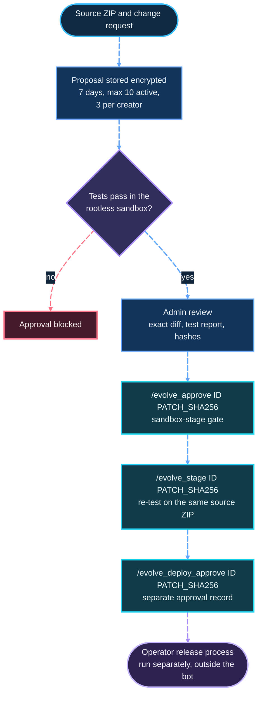

> [!NOTE]
> Secret-named files are excluded from the source ZIP. Protected security, dependency, configuration, storage, handler, sandbox and deployment paths are excluded from automated evolution tests. Production deploy and restart are never run by this workflow. Details: [Mission Control](docs/MISSION_CONTROL_ARCHITECTURE.md), [self-evolution](docs/SELF_EVOLUTION_WORKFLOW.md), [Telegram approvals](docs/TELEGRAM_APPROVALS.md).

### Code review and sandbox

- **Review and patch.** Reply to a project ZIP with `/patch <description of the change>` to get a source review and a downloadable patch. In private chats an accepted patch is kept as an encrypted proposal for at most 7 days. When rootless Docker is enabled the patch is tested, and then admin review and approval are required. The bot never modifies its own running source.
- **Run tests on demand.** Reply to a ZIP with `/test`, then approve with `/approve ID` (or reject with `/deny ID`). Tests stay disabled until the operator configures rootless Docker, builds the sandbox image and sets `CODE_SANDBOX_ENABLED=true` (see [Deployment](#deployment)).
- **Isolation.** Containers run with `--network=none`, a read-only root filesystem, dropped capabilities, `no-new-privileges` and PID, CPU, RAM and time caps. The project is copied from a read-only bind mount into a bounded tmpfs, and no image is pulled at runtime. The sandbox image contains Python, pytest and `git apply`; extra project dependencies need a trusted prebuilt image supplied by the operator.

### Operations and administration

- **Mission Control dashboard.** Private, loopback-only admin UI with provider, usage, job, approval and audit views, sanitized in-memory logs and push-to-talk. See [Mission Control Dashboard](#mission-control-dashboard).
- **Health snapshots and alerts.** The admin dashboard shows disk and RAM availability and a health snapshot, plus load average on Linux (on Windows unsupported memory and load values show as unavailable). The admin is alerted at most once every six hours when free disk drops below 1 GiB or RAM usage exceeds 95%.
- **Malware scanning.** The Ubuntu installer sets up the ClamAV daemon and its signature updater. On a deployed bot every Telegram upload is scanned before AI processing, a detection alerts the admin, and if the scanner fails, unscanned uploads stay blocked (fail closed). See [`docs/DEPLOYMENT_AZURE_VM.md`](docs/DEPLOYMENT_AZURE_VM.md).
- **VM controls.** `/vm status|logs|restart` shows service status and sanitized in-memory app logs and performs a graceful bot restart after approval. The systemd unit uses `Restart=always`. VM controls never run arbitrary shell commands.
- **Home Assistant.** Provide an HTTPS `HA_BASE_URL`, `HA_TOKEN`, `HA_ALLOWED_ENTITIES` and `HA_ALLOWED_SERVICES`. HTTPS is mandatory except for a local instance at `http://localhost`. Only allowlisted entities and services can be used, and every state-changing request needs admin approval. Admins use `/device status|service.domain entity_id`.
- **Moderation and support.** `/block USER_ID [reason]` and `/unblock USER_ID` provide bot-local moderation. Reply to a support notice to deliver a formatted admin response. Admin IDs are checked in every command and in the support-reply route.
- **Live updates by ZIP.** `/update` extracts a ZIP sent by the admin straight into the project root and restarts the bot process.

> [!WARNING]
> `/update` changes live code and restarts the process immediately. Only the admin identified by `ADMIN_ID` in `.env` is authorised. `.env`, the database and persistent paths (`data/`, `uploads/`, `backups/`) are excluded from overwrite, and archive paths, symlinks and size limits are validated. Read [`TELEGRAM_ZIP_UPDATES`](docs/TELEGRAM_ZIP_UPDATES.md), [`UPDATE_SECURITY`](docs/UPDATE_SECURITY.md) and [`UPDATE_TROUBLESHOOTING`](docs/UPDATE_TROUBLESHOOTING.md) before using it.

<p align="center"></p>

<p align="center"></p>

<h2 align="center">Architecture</h2>

<p align="center"><i>A small, explicit module map. Each concern has exactly one home.</i></p>


The diagram is conceptual: magenta nodes are entry points, cyan nodes are Enan Ultra modules and violet nodes are external systems. [`docs/ARCHITECTURE.md`](docs/ARCHITECTURE.md) is the authoritative module guide.

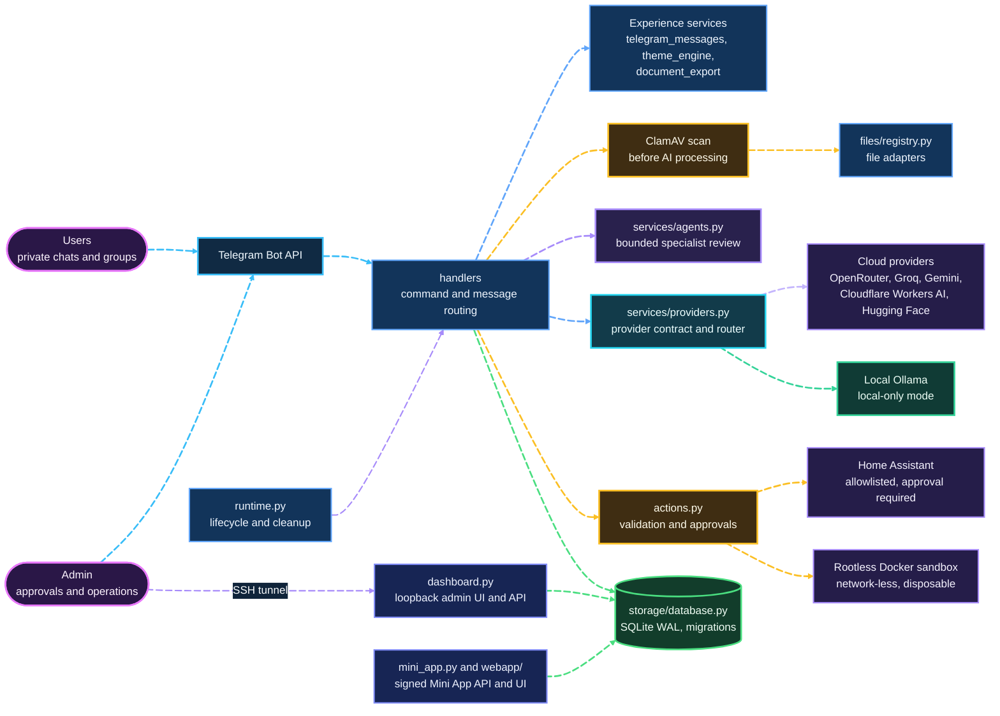

| Module | Responsibility |
|---|---|
| `handlers` | Command and Telegram message routing |
| `services/telegram_messages.py` | Shared formatter, Rich Message transport and fallback |
| `services/theme_engine.py` | Topic detection and per-user themes |
| `mini_app.py` | Optional signed Mini App API |
| `webapp/static` · `webapp/themes` | Mini App UI · theme registry |
| `services/document_export.py` | Private Markdown, TXT and PDF export |
| `services/providers.py` | Provider contract and router |
| `services/agents.py` | Bounded specialist review |
| `files/registry.py` | File adapter registry |
| `actions.py` | Validation and action approval |
| `storage/database.py` | Persistence and migrations |
| `dashboard.py` | Private admin API and UI |
| `runtime.py` | Lifecycle and cleanup |

Go deeper: [features](docs/FEATURES.md) · [architecture](docs/ARCHITECTURE.md) · [Mini App](docs/MINI_APP.md) · [Rich Messages](docs/TELEGRAM_RICH_MESSAGES.md) · [admin guide](docs/ADMIN_GUIDE.md) · [configuration](docs/CONFIGURATION.md) · [Azure deployment](docs/DEPLOYMENT_AZURE_VM.md) · [troubleshooting](docs/TROUBLESHOOTING.md)


<p align="center"></p>

<p align="center"></p>

<h2 align="center">Quick Start</h2>

<p align="center"><i>From clone to a running bot in five steps.</i></p>


**You need:** Python **3.11–3.15** (3.11 is the minimum supported version), [`uv`](https://docs.astral.sh/uv/), a Telegram bot token from [@BotFather](https://t.me/BotFather), your numeric Telegram admin user/chat ID and at least one supported AI provider key.

**1. Clone the repository**

```sh
git clone https://github.com/shajeduzzamanenan992008inc/Telegram-Bot.git
cd Telegram-Bot
```

**2. Generate your environment file**

```sh
python scripts/init_env.py
```

`init_env.py` creates `.env` and fills `APP_DATA_KEY` and `DASHBOARD_AUTH_TOKEN` with cryptographically secure random values. `.env` is not tracked by Git and is written with mode `0600` on Linux.

**3. Configure `.env`**

Set the Telegram bot token, the numeric admin chat/user ID (`ADMIN_ID`) and at least one provider key. See [Configuration](#configuration) for every variable.

**4. Install locked dependencies**

```sh
uv sync --locked --group build --group test
```

**5. Run**

```sh
uv run enan-ultra
```

Open Telegram, find your bot and send `/start`. For a production host, continue with [Deployment](#deployment).

> [!TIP]
> Want to try the **brand kit** first? The starter bot in [`assets/11-starter-bot`](assets/11-starter-bot) is a tiny aiogram 3 demo that sends the menu cards and the welcome animation. See the [Brand and Asset Library](#brand-and-asset-library).

<p align="center"></p>

<p align="center"></p>

<h2 align="center">Configuration</h2>

<p align="center"><i>Provider keys, routing policy, limits and integrations.</i></p>


Full reference: [`docs/CONFIGURATION.md`](docs/CONFIGURATION.md) · [`docs/PROVIDER_SETUP.md`](docs/PROVIDER_SETUP.md)

### AI providers

| Provider | API key variable | Notes |
|---|---|---|
| OpenRouter | `OPENROUTER_API_KEYS` | Also powers web search, remote file fallback, transcription, image generation and OpenRouter TTS. |
| Groq | `GROQ_API_KEYS` | Set the matching `*_MODEL` variable. |
| Gemini | `GEMINI_API_KEYS` | Use `GEMINI_API_KEY`, **not** `GOOGLE_AI_STUDIO_KEY`. Set the matching `*_MODEL` variable. |
| Cloudflare Workers AI | `CLOUDFLARE_API_TOKENS` | Requires `CLOUDFLARE_ACCOUNT_ID`. The legacy alias `CLOUDFLARE_API_KEYS` still works, and the singular token variable is `CLOUDFLARE_API_KEY`. Set the matching `*_MODEL` variable. |
| Hugging Face | `HUGGINGFACE_API_KEYS` | Endpoint defaults to `https://router.huggingface.co/v1`; override with `HUGGINGFACE_BASE_URL`. Set the matching `*_MODEL` variable. |

- Every plural variable accepts **comma-separated keys** that are used round-robin. If a plural variable is empty, the matching singular `*_API_KEY` variable is used as a fallback.
- A `401` quarantines the rejected key. `402` and `429` never try sibling keys; the cooldown is respected instead.
- Local-only privacy mode is configured separately with a local Ollama.

### Routing, cost and limits

| Variable | Purpose |
|---|---|
| `AI_PROVIDER_ORDER` | Failover order of cloud providers (default: OpenRouter → Groq → Gemini → Cloudflare → Hugging Face). |
| `DEFAULT_AI_MODEL` | `auto` uses the first suitable model in the provider order. Admins change it at runtime with `/model provider::model-id`; `/models` lists the choices. |
| `FALLBACK_MODELS` | Additional model-level fallback. |
| `AI_FREE_ONLY` | `true` keeps cloud models disabled unless they are on an exact `provider::model-id` allowlist. |
| `AI_ALLOW_PAID_FALLBACK` · `AI_MAX_ESTIMATED_COST_USD` | Paid fallback needs `AI_ALLOW_PAID_FALLBACK=true` **and** a positive `AI_MAX_ESTIMATED_COST_USD`. |
| `USER_MONTHLY_REQUEST_LIMIT` · `USER_MONTHLY_COST_LIMIT_USD` | Account-level monthly budget caps, on top of the per-user daily request limit. `/usage` shows both. |
| `AGENT_MAX_STEPS` · `AGENT_MAX_WORKERS` | Steps per mission and the global worker cap. |

### Media, voice and vision

| Variable | Purpose |
|---|---|
| `VISION_MODEL` | OpenRouter vision model (default `google/gemini-2.5-flash:free`). |
| `IMAGE_MODEL` | Image-output model ID from OpenRouter's current image-model catalog; otherwise an available image model is used. |
| `TTS_MODEL` · `TTS_VOICE` | Audio-output model for OpenRouter TTS and an optional provider-specific voice. Without `TTS_MODEL`, or on failure, gTTS is used. |
| `MAX_IMAGE_PIXELS` | Decompression-bomb guard on top of the image byte limit. |

### Security, secrets and integrations

| Variable | Purpose |
|---|---|
| `APP_DATA_KEY` | Source of the Fernet key that encrypts the Personal KB and database backups. **Keep it: without the same key, backups and KB cannot be decrypted.** |
| `DASHBOARD_AUTH_TOKEN` | Login secret for the Mission Control dashboard. |
| `ADMIN_ID` | The only identity allowed to use `/update`. |
| `CODE_SANDBOX_ENABLED` | `true` enables sandboxed `/test` and patch testing once rootless Docker and the sandbox image are ready. |
| `HA_BASE_URL` · `HA_TOKEN` · `HA_ALLOWED_ENTITIES` · `HA_ALLOWED_SERVICES` | Home Assistant integration; HTTPS is mandatory except for `http://localhost`. |
| `DATABASE_PATH` | Database location, used by the backup and restore script. |

> [!CAUTION]
> Never expose `.env`, `/etc/telegram-ai/bot.env`, Telegram or provider keys, the Home Assistant token or the dashboard secret in backups, logs or API responses.

<p align="center"></p>

<p align="center"></p>

<h2 align="center">Command Reference</h2>

<p align="center"><i>Every slash command, grouped by task.</i></p>


Arguments in `<angle brackets>` are required, `[square brackets]` are optional, and `a|b` means choose one. In the bot, `/help` is always the source of truth for your build.

### Getting started and preferences

| Command | What it does |
|---|---|
| `/start` · `/help` | Start the bot and show help. |
| `/language` · `/style` · `/media` · `/live` · `/exit` · `/id` | Session and preference helpers, listed in the bot's `/help`. See [`docs/FEATURES.md`](docs/FEATURES.md). |
| `/voice [on]` | Turns on voice replies (the confirmation is sent as a voice note too). |
| `/format text\|markdown\|json` | Sets the preferred answer structure. JSON mode is prompt guidance, not a strict schema validator. |
| `/setmode default\|sarcastic\|anime\|professional\|regional` | Per-chat response style. |
| `/persona default\|expert\|creative\|research\|tutor\|professional\|debate` | Personal answer style. `/persona custom <instructions>` stores up to 500 characters, below system and safety rules. |
| `/theme [auto\|off\|reset\|learning on\|off\|theme-id]` | Adaptive theme controls, for example `/theme programming`, `/theme auto`, `/theme learning off`. |
| `/app` | Opens the optional Telegram Mini App. |
| `/timezone <IANA name>` | Validates and stores your timezone, for example `/timezone Asia/Dhaka`. |
| `/usage` | Daily and monthly consumption. |
| `/cancel` | Stops the active provider request and keeps any generated text. |

### Ask, search and research

| Command | What it does |
|---|---|
| `/search <web query>` · `/research <web query>` | Retrieves up to three DuckDuckGo snippets and synthesizes a Bengali answer through OpenRouter, with source URLs. |
| `/read https://example.com` | Summarizes a public HTTPS page. Rejects private hosts and redirects, downloads at most 2 MiB and sends only extracted text (up to 3,000 characters) to the configured AI router. |
| `/historysearch <term>` | Searches your saved conversation text locally. |
| `/web on\|off` | Toggles web search. |
| `/image <prompt>` · `/imagine <prompt>` | Image generation through OpenRouter's image-models API. |
| `/translate <language> <text>` | Translates into `bn`, `en`, `ar`, `hi`, `ur`, `es`, `fr`, `de`, `ja` or `zh`. Follows your privacy mode and usage limits. |
| `/summary` | Summarizes the latest 80 text messages in a group. |
| `/agents on\|off\|status` | Controls budget-limited specialist review. |
| `/feedback good\|bad [category]` | Stores a bounded feedback category. |

### Memory, knowledge, files and privacy

| Command | What it does |
|---|---|
| `/memory` | `on` enables asynchronous extraction, `learn off` stops extraction but keeps stored memory, `off` disables both. |
| `/remember <fact>` | Saves an explicit fact to your memory. |
| `/forget [ID\|all]` | Removes one memory or all of them. |
| `/clear` · `/reset` | Clears the private conversation history **and** all stored user memory. |
| `/temporary on\|off` | Runs private AI conversations without history, memory, document or personal-KB retrieval. |
| `/document [files\|forget]` · `/files` · `/forget_files` | Manage retained document indexes. |
| `/kb` · `/knowledge` | `on`, `off`, `save ID`, `search <query>`, `list`, `delete ID` or `all` for the encrypted Personal Knowledge Base. |
| `/privacy local\|cloud\|export` | Shows active data flows, switches privacy mode and exports your stored data as JSON. |
| `/privacy delete confirm` | Deletes user-linked account data. |
| `/export md\|txt\|pdf` | Exports saved private-chat history. `/export file ID md\|txt` exports extracted text from a retained document index. |

### Study, reminders and tasks

| Command | What it does |
|---|---|
| `/study on\|off\|status` | Turns Study Mode on or off. |
| `/study card add <question> :: <answer>` | Adds a private flashcard. |
| `/study due` · `/study review ID good\|again` · `/study cards` | Spaced review and card list. |
| `/study quiz <topic>` | Sends an AI-generated multiple-choice question as a native Quiz Poll. |
| `/remind 10m <text>` | Relative reminder. Add `daily` or `weekly` (`/remind 10m daily <text>`) for recurrence. |
| `/remind YYYY-MM-DD HH:MM <text>` | One-time reminder in your timezone's local time. |
| `/reminders` · `/reminders pause ID\|resume ID` | List (in local time), pause and resume reminders. |
| `/snooze ID 10m` · `/cancelreminder ID` | Postpone or cancel a pending reminder. |
| `/tasks add\|plan\|list\|done ID\|delete ID` | Task manager. `add` supports `priority=high due=2026-12-31 after=ID`; `plan <goal\|chat>` builds up to 10 tasks with dependencies. |

### Stickers

| Command | What it does |
|---|---|
| `/make_sticker` | Creates a static WebP sticker from a photo caption or a reply to a photo. |
| `@BOT_USERNAME <keyword>` | Inline mode: up to 20 matches from approved sticker metadata (enable inline mode in BotFather). |
| `/collect_on` | Starts sticker-metadata collection into pending review (configured admin private chat only; default-off). |
| `/import_sticker_set <short_name>` | Imports a pack's metadata through the Bot API. |
| `/sticker_review` · `/sticker_categorize` · `/sticker_search` · `/sticker_stats` · `/sticker_export` | Review, categorize, search, inspect and export the catalog. |

### Missions

| Command | What it does |
|---|---|
| `/mission_new <task>` | Splits a request into read-only analysis steps (up to `AGENT_MAX_STEPS`). |
| `/mission_list` · `/mission_status ID` · `/mission_report ID` | List missions, check progress and read the report. |
| `/mission_pause ID` · `/mission_resume ID` · `/mission_cancel ID` · `/mission_delete ID` | Control and remove missions. |

### Approvals, devices and ZIP workflows

| Command | What it does |
|---|---|
| `/approve ID` · `/deny ID` | Approve or deny a pending action. |
| `/test` | Reply to a project ZIP to run its tests in the rootless sandbox (after confirmation). |
| `/patch <request>` | Reply to a project ZIP to get a source review and a downloadable patch. |
| `/update` | **Admin.** Sends a ZIP that is extracted into the project root, then restarts the bot. |
| `/device status\|service.domain entity_id` | **Admin.** Allowlisted Home Assistant control. |
| `/vm status\|logs\|restart` | **Admin.** Service status, sanitized logs and graceful restart after approval. |

### Administration

| Command | What it does |
|---|---|
| `/admin` · `/status` · `/providers` | Admin overview, status and provider information (see the [admin guide](docs/ADMIN_GUIDE.md)). |
| `/model provider::model-id` · `/models` | Switch and list models. |
| `/providerdiag` · `/providerdiag recheck <provider>` | Local circuit and key health; recheck a provider and reset its quarantine. |
| `/block USER_ID [reason]` · `/unblock USER_ID` | Bot-local moderation. |
| `/clearuser USER_ID` · `/resetuser USER_ID` | Per-user cleanup and reset. |
| `/end USER_ID` · `/endall` (alias `/end_all`) | Session termination controls. |
| `/learning_status` · `/learning_pause` · `/learning_resume` | Inspect, pause and resume feedback intake and fact extraction. |
| `/evolve_status` · `/evolve_pending` · `/evolve_review ID` · `/evolve_test ID` | Inspect proposals, exact diffs, test reports and hashes. |
| `/evolve_approve ID PATCH_SHA256` · `/evolve_stage ID PATCH_SHA256` · `/evolve_deploy_approve ID PATCH_SHA256` · `/evolve_cancel ID PATCH_SHA256` | Hash-pinned approval pipeline, see [Agents and controlled improvement](#agents-and-controlled-improvement). |

> [!NOTE]
> Group text messages are kept in a bounded, per-group SQLite window of up to 100 messages; `/summary` uses the latest 80. Admins can also clear a user's memory from the dashboard's *Active users* section. Admin user IDs are checked in every command and in the support-reply route.

<p align="center"></p>

<p align="center"></p>

<h2 align="center">Mission Control Dashboard</h2>

<p align="center"><i>A private operations console that can observe a lot and change almost nothing.</i></p>


The dashboard binds to `127.0.0.1:8787` by default. Reach it from your own computer through an SSH tunnel:

```sh
ssh -L 8787:127.0.0.1:8787 enan-ultra@YOUR_VM
```

Then open `http://127.0.0.1:8787` and sign in with `DASHBOARD_AUTH_TOKEN` from `/etc/telegram-ai/bot.env`.

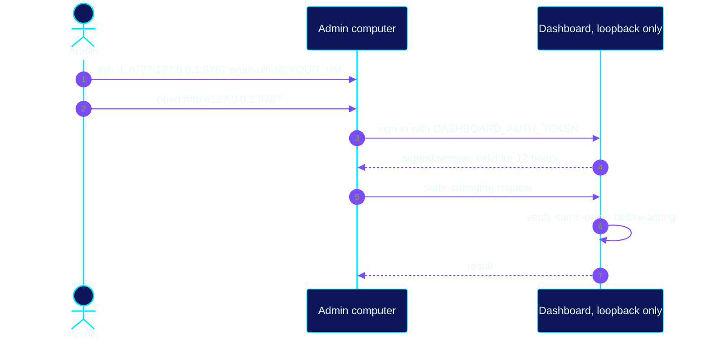

| Area | Details |
|---|---|
| **Observe** | Provider, usage, job, approval and audit views; sanitized in-memory app logs; disk and RAM availability, health snapshot and, on Linux, load average. |
| **Sessions** | Login issues a signed 12-hour session. Login attempts are rate limited and state-changing requests verify the same origin. |
| **Voice** | Push-to-talk only turns the microphone on and transcribes. It never executes a command. |
| **Home Assistant** | Allowlisted entities and services only. Every state-changing request needs admin approval. |
| **Restart** | A confirmed bot-service restart is available. |
| **Privacy** | The dashboard shows no user chats and no Personal KB content. |
| **Never** | No arbitrary shell, no reboot and no package-update endpoint. Provider API keys are never displayed. |


<p align="center"></p>

<p align="center"></p>

<h2 align="center">Security and Privacy</h2>

<p align="center"><i>Controls you can read, audit and test, not promises.</i></p>


### Privacy modes and data flows

`/privacy` in the bot tells each user which data flows are active.

| | **Cloud mode** | **Local-only mode** |
|---|---|---|
| Text and images | Sent to the configured provider | Sent **only** to the configured local Ollama |
| Web search, remote file fallback, transcription, image generation | Need OpenRouter | Disabled |
| Voice replies | OpenRouter TTS first when `TTS_MODEL` is set; otherwise, or on failure, gTTS, which sends text to Google's external TTS service | Remote TTS disabled |
| Unsupported-file fallback | Available | Disabled |
| Cloud fallback | Ordered failover across providers | None |

### Defense in depth

| Layer | Controls |
|---|---|
| **Identity and access** | Admin user IDs are checked in every command and support-reply route. `/update` is limited to the `ADMIN_ID` in `.env`. The dashboard needs a token, issues signed 12-hour sessions, rate-limits logins and verifies same-origin on state-changing requests. It binds to loopback and is reached through an SSH tunnel. |
| **Data at rest** | Personal KB and database backups are encrypted with a Fernet key derived from `APP_DATA_KEY`. Mission requests, plans and results, and `/patch` and evolution proposals, are encrypted in SQLite. The KB is user-isolated. The service env file is root-owned with mode `0600`. |
| **Secrets hygiene** | Provider API keys never appear in the dashboard, the API or logs. `.env` is untracked by Git. Secret-named files are excluded from source ZIPs used for proposals. |
| **Untrusted input** | File content, retrieved passages, usernames and agent reviews are treated as untrusted data, and tool permissions never depend on prompt text. Archives get path-traversal, symlink, member-count and expanded-size checks. Uploaded source, macros and executables are never run during normal file reading. |
| **Resource abuse** | Image byte and `MAX_IMAGE_PIXELS` limits guard against decompression bombs, and scanned-PDF OCR renders are capped at 2048 px. `/read` rejects private hosts and redirects, caps downloads at 2 MiB and sends at most 3,000 characters to the router. |
| **Malware** | ClamAV scans uploads before AI processing on a deployed bot. A detection alerts the admin, and a scanner failure blocks the upload (fail closed). |
| **Execution safety** | State-changing actions need explicit approval. Evolution approvals are pinned to a patch SHA-256. Tests run only in a rootless, network-less, disposable container with a read-only root filesystem, dropped capabilities, `no-new-privileges` and PID, CPU, RAM and time caps. Specialist agents and missions have no tools that act. There is no arbitrary-shell endpoint in the dashboard or VM controls. |
| **Cost and abuse control** | Per-user daily limits, monthly request and cost budgets, free-tier-only mode, key quarantine with cooldowns, bounded group windows, mission caps, and bot-local `/block` and `/unblock`. |
| **Resilience** | Encrypted snapshots every 24 hours, a hardened systemd unit with `Restart=always`, and disk and RAM alerts. |

### Data lifecycle and retention

| Data | Bound or retention |
|---|---|
| Group text messages | Bounded per-group SQLite window of up to 100 messages |
| Temporary uploaded-file index | Expires on a schedule; per-user document and size caps apply |
| OCR and ffmpeg temporary files | Removed when the work finishes |
| Generated voice MP3 | Temporary file removed after sending |
| Remote provider files | Deleted when the request ends; failed deletions go to a retry queue |
| `/patch` proposals from private chats | Encrypted, kept at most 7 days |
| Evolution proposals | Encrypted for 7 days; at most 10 active, 3 per creator |
| Mission content | Deleted after 30 days; terminal metadata cleaned within 90 days of its last update |
| Database snapshots | Every 24 hours; the latest 7 are kept |
| Learned facts | Removed by `/forget all`, `/clear`, `/reset` and account deletion |
| Account data | `/privacy export` and `/privacy delete confirm`; shared group history is not touched by account actions |
| Dashboard session | 12 hours |

Guides: [`PRIVACY_AND_FILE_RETENTION`](docs/PRIVACY_AND_FILE_RETENTION.md) · [`KNOWLEDGE_BASE`](docs/KNOWLEDGE_BASE.md) · [`UPDATE_SECURITY`](docs/UPDATE_SECURITY.md) · [`TELEGRAM_APPROVALS`](docs/TELEGRAM_APPROVALS.md)

### Reporting a vulnerability

Please do **not** post exploit details, tokens or keys in a public issue. Open a GitHub issue that says only that you have a security report, so the maintainer can arrange a private channel.

<p align="center"></p>

<p align="center"></p>

<h2 align="center">Deployment</h2>

<p align="center"><i>Production on Ubuntu with systemd, built for an Azure VM.</i></p>


### Ubuntu / systemd

Check the repository out on the VM and run the installer:

```sh
sudo bash deploy/install_ubuntu.sh
```

The installer defaults to Python 3.11 (supported range 3.11–3.15). To pick another supported version:

```sh
PYTHON_VERSION=3.14 sudo -E bash deploy/install_ubuntu.sh
```

It sets up locked dependencies, `ffmpeg`, Poppler, Bengali and English Tesseract, the Noto Bengali font (`fonts-noto-core`), the ClamAV daemon with its signature updater, a non-root service account and a hardened systemd unit.

`/etc/telegram-ai/bot.env` is root-owned with mode `0600`. The first run generates secrets, later runs keep them intact and add any new config keys to an older env file. Fill in your credentials and run the installer again:

```sh
sudoedit /etc/telegram-ai/bot.env
sudo bash deploy/install_ubuntu.sh
sudo systemctl status telegram-ai
sudo journalctl -u telegram-ai -f
```

Details: [`docs/DEPLOYMENT_AZURE_VM.md`](docs/DEPLOYMENT_AZURE_VM.md) · [`docs/TROUBLESHOOTING.md`](docs/TROUBLESHOOTING.md)

### Optional: code sandbox with rootless Docker

Sandboxed tests are **off** until the operator completes these steps:

1. Configure rootless Docker ([Docker rootless mode](https://docs.docker.com/engine/security/rootless/)).
2. Build the sandbox image:

   ```sh
   docker build -f deploy/code-sandbox.Dockerfile -t enan-ultra-python-sandbox:py3.15.0-pytest9.1.1 .
   ```

3. For the system service `deploy/telegram-ai.service`, set the rootless daemon's `DOCKER_HOST` and `XDG_RUNTIME_DIR` in a systemd drop-in.
4. Set `CODE_SANDBOX_ENABLED=true`.

Before every test run the bot verifies that the Docker daemon is rootless. Project dependencies beyond Python, pytest and `git apply` require a trusted prebuilt image from the operator.

### Windows (development)

`python scripts/init_env.py` and `uv run enan-ultra` work for local development. On Windows, unsupported memory and load values show as unavailable in the dashboard, and PDF exports use the Nirmala UI font for Bangla.

### Optional: Mini App hosting

The Mini App is optional and needs an HTTPS domain, a reverse proxy and signed Telegram identity validation. Setup and limitations: [`docs/MINI_APP.md`](docs/MINI_APP.md).

<p align="center"></p>

<p align="center"></p>

<h2 align="center">Backup and Restore</h2>

<p align="center"><i>Encrypted, rotated, and restorable on purpose.</i></p>


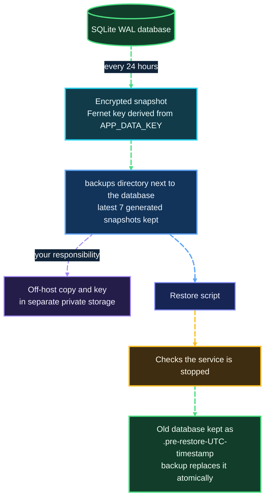

Create an encrypted backup and restore it (reading the key from the installer's `/etc/telegram-ai/bot.env` needs root):

```sh
sudo env DATABASE_PATH=/var/lib/telegram-ai/telegram_ai.sqlite3 \
  /opt/enan-ultra/.venv/bin/python /opt/enan-ultra/current/scripts/database_backup.py backup \
  /var/lib/telegram-ai/backups/telegram_ai.sqlite3.enc

sudo systemctl stop telegram-ai
sudo env DATABASE_PATH=/var/lib/telegram-ai/telegram_ai.sqlite3 \
  /opt/enan-ultra/.venv/bin/python /opt/enan-ultra/current/scripts/database_backup.py restore \
  /var/lib/telegram-ai/backups/telegram_ai.sqlite3.enc --to /var/lib/telegram-ai/telegram_ai.sqlite3 --replace
sudo systemctl start telegram-ai
```

> [!IMPORTANT]
> Restoring needs the **same `APP_DATA_KEY`**. If the key is lost, backups and the Personal KB can no longer be decrypted. Keep off-host copies and the key in separate private storage.

- Restore keeps the previous database as `.pre-restore-<UTC timestamp>`, replaces it atomically and checks that the service is stopped first.
- Restoring an older **plaintext** backup requires an explicit `--allow-unencrypted`.
- The sticker catalog is part of the main database and therefore part of every encrypted snapshot.

<p align="center"></p>

<p align="center"></p>

<h2 align="center">Quality and CI</h2>

<p align="center"><i>Locked dependencies, a five-version test matrix and honest limits.</i></p>


`pyproject.toml` holds the direct dependency pins and `uv.lock` is the source of truth for transitive dependencies. Export `requirements.txt` from the lock and run the tests:

```sh
uv lock
uv export --locked --format requirements.txt --no-dev --group build --output-file requirements.txt
uv run --locked --group test pytest
```

| Area | What CI covers |
|---|---|
| **Matrix** | Python 3.11, 3.12, 3.13, 3.14 and 3.15 |
| **Static checks** | Correctness lint, Python compile, Mini App JavaScript syntax |
| **Packaging** | Wheel build and packaged web/theme asset check |
| **Tests** | Provider fallback, local-only routing, encrypted KB isolation, approval authorization and expiry, per-message one-shot tool actions, usage caps, image pixel limit, archive traversal and bounds, deployment-secret generation and config behaviour |

> [!NOTE]
> External integration smoke tests cannot complete without real Telegram, provider and Home Assistant credentials and a rootless Docker daemon.

<p align="center"></p>

<p align="center"></p>

<h2 align="center">Documentation Map</h2>

<p align="center"><i>Deep dives that live next to the code.</i></p>


| Topic | Guides |
|---|---|
| **Start here** | [`FEATURES`](docs/FEATURES.md) · [`ARCHITECTURE`](docs/ARCHITECTURE.md) · [`CONFIGURATION`](docs/CONFIGURATION.md) · [`ADMIN_GUIDE`](docs/ADMIN_GUIDE.md) · [`TROUBLESHOOTING`](docs/TROUBLESHOOTING.md) |
| **Deployment** | [`DEPLOYMENT_AZURE_VM`](docs/DEPLOYMENT_AZURE_VM.md) |
| **AI providers** | [`AI_PROVIDER_ARCHITECTURE`](docs/AI_PROVIDER_ARCHITECTURE.md) · [`PROVIDER_SETUP`](docs/PROVIDER_SETUP.md) · [`PROVIDER_CAPABILITIES`](docs/PROVIDER_CAPABILITIES.md) · [`FAILOVER_AND_RETRY`](docs/FAILOVER_AND_RETRY.md) · [`FREE_TIER_AND_COST_CONTROL`](docs/FREE_TIER_AND_COST_CONTROL.md) |
| **Experience** | [`ADAPTIVE_THEME_ENGINE`](docs/ADAPTIVE_THEME_ENGINE.md) · [`MINI_APP`](docs/MINI_APP.md) · [`TELEGRAM_RICH_MESSAGES`](docs/TELEGRAM_RICH_MESSAGES.md) · [`VOICE_INTELLIGENCE`](docs/VOICE_INTELLIGENCE.md) · [`MULTIMODAL_ARCHITECTURE`](docs/MULTIMODAL_ARCHITECTURE.md) |
| **Knowledge and data** | [`DOCUMENT_PROCESSING`](docs/DOCUMENT_PROCESSING.md) · [`KNOWLEDGE_BASE`](docs/KNOWLEDGE_BASE.md) · [`WEB_RESEARCH`](docs/WEB_RESEARCH.md) · [`PRIVACY_AND_FILE_RETENTION`](docs/PRIVACY_AND_FILE_RETENTION.md) |
| **Stickers** | [`STICKER_COLLECTION`](docs/STICKER_COLLECTION.md) · [`STICKER_DATABASE`](docs/STICKER_DATABASE.md) · [`STICKER_IMPORT`](docs/STICKER_IMPORT.md) · [`STICKER_CATEGORIZATION`](docs/STICKER_CATEGORIZATION.md) · [`STICKER_TROUBLESHOOTING`](docs/STICKER_TROUBLESHOOTING.md) |
| **Agents and approvals** | [`MISSION_CONTROL_ARCHITECTURE`](docs/MISSION_CONTROL_ARCHITECTURE.md) · [`SELF_EVOLUTION_WORKFLOW`](docs/SELF_EVOLUTION_WORKFLOW.md) · [`TELEGRAM_APPROVALS`](docs/TELEGRAM_APPROVALS.md) |
| **Updates** | [`TELEGRAM_ZIP_UPDATES`](docs/TELEGRAM_ZIP_UPDATES.md) · [`UPDATE_SECURITY`](docs/UPDATE_SECURITY.md) · [`UPDATE_TROUBLESHOOTING`](docs/UPDATE_TROUBLESHOOTING.md) |
| **Brand and licensing** | [Asset pack README](assets/README.md) · [Brand guide](assets/08-text-kit/brand-guide.md) · [Licensing drafts](docs/licensing-draft/) |


<p align="center"></p>

<p align="center"></p>

<h2 align="center">Brand and Asset Library</h2>

<p align="center"><i>A complete, animated, production-ready visual identity: 268 files in 15 folders.</i></p>


The repository ships a full visual identity for the bot: logos, banners, backgrounds, icons, status elements, stickers, video loops, ready-to-upload PNG exports, menu cards, a landing page and a starter bot.

- **125 SVG files, 108 of them animated.** Every SVG is self-contained (no external fonts, scripts or images), animates natively in GitHub READMEs and browsers and loops on an 8.5-second cycle (or a divisor of it), so nothing jumps when it restarts.
- **Outline wordmark.** The wordmark is drawn from outlines, so it looks identical everywhere without font files.
- **Telegram needs raster or video.** Telegram does not play SVG animation. Inside Telegram use the PNG, JPG, MP4 and WebM files.
- **Best on dark.** The logos are transparent and designed for dark backgrounds (`#02030C` to `#0C1658`).

### Kit at a glance

| Folder | Kit | Contents | Files |
|---|---|---|---|
| [`01-logo`](assets/01-logo) | **Logo** | Primary logo, emblem, wordmark and animated bot avatar | 4 |
| [`02-banners`](assets/02-banners) | **Banners** | GitHub 1280×640, X header 1500×500, link preview 1200×630, Story 1080×1920, BotFather 640×360 | 5 |
| [`03-backgrounds`](assets/03-backgrounds) | **Backgrounds** | Thunderstorm (desktop and mobile), neon grid, transparent lightning-and-rain overlay | 4 |
| [`04-icons`](assets/04-icons) | **Icons** | 26 neon icons plus an icon sheet | 27 |
| [`05-elements`](assets/05-elements) | **UI elements** | Loader, progress bar, divider, 5 status badges, thunder cloud, bolt, typing indicator, HUD frame, success and error animations | 14 |
| [`06-stickers`](assets/06-stickers) | **Stickers** | 8 neon stickers (SVG) and 7 Telegram video stickers (WebM) | 15 |
| [`07-png-exports`](assets/07-png-exports) | **PNG exports** | Ready-to-upload PNGs: avatar, description picture, banners, logos, icons, emoji, stickers, creator, status, Telegram identity, backgrounds | 89 |
| [`08-text-kit`](assets/08-text-kit) | **Text kit** | BotFather commands and texts (EN/BN), message and announcement templates, keyboards, about and credits, README template, brand guide | 8 |
| [`09-static-svg`](assets/09-static-svg) | **Static SVG** | Non-animated versions for docs, e-mail and print | 16 |
| [`10-video`](assets/10-video) | **Video** | Looping MP4: welcome, animated avatar, thunderstorm, loading, success, error, creator badge | 7 |
| [`11-starter-bot`](assets/11-starter-bot) | **Starter bot** | aiogram 3 demo wired to the menu cards and the welcome video | 4 |
| [`12-creator`](assets/12-creator) | **Creator** | Creator and Builder badge, monogram, wide credit line and "built by" watermark | 4 |
| [`13-menu-cards`](assets/13-menu-cards) | **Menu cards** | 22 header images, 1280×720 (JPG and SVG) | 44 |
| [`14-landing-page`](assets/14-landing-page) | **Landing page** | Animated landing page (index.html plus assets) | 14 |
| [`15-telegram`](assets/15-telegram) | **Telegram identity** | Six "Open in Telegram"-style buttons, "Available on Telegram" badge, QR frame, paper-plane hero | 9 |
| [`assets`](assets) | **Root files** | Pack README, animated-asset preview page, this README's hero banner and "Open in Telegram" button | 4 |
|  | **Total** |  | **268** |

### Visual identity

| Swatch | Name | Hex | Use |
|:---:|---|---|---|
|  | Electric Cyan | `#00E5FF` | Primary neon, eyes, rain, links |
|  | Storm Violet | `#7C4DFF` | Secondary neon, rings |
|  | Plasma Magenta | `#FF2BD6` | Gradient end, accents |
|  | Telegram Blue | `#2AABEE` / `#229ED9` | Paper plane, "Open in Telegram" |
|  | Midnight | `#02030C` / `#070C2A` / `#0C1658` | Backgrounds |
|  | Lightning White | `#EAF8FF` | Bolts, highlights |
|  | Premium Gold | `#FFC857` | Premium and warning badges |
|  | Signal Green | `#00FF9D` | Online and success |
|  | Alert Red | `#FF3B6B` | Errors and admin |

- **Brand gradient:** Cyan → Violet → Magenta (diagonal for shapes, horizontal for text).
- **Typography** (for text outside the logo): headings in **Orbitron**, body in **Rajdhani** or **Exo 2**, all free on Google Fonts.
- **Logo:** the emblem is a hex shield, a bot head and a lightning antenna. Keep clear space equal to a quarter of the emblem width. For avatars, keep everything important inside a centred circle because Telegram crops avatars to a circle.
- **Motion:** everything loops every 8.5 s (or a divisor of it) so videos and SVGs loop without a jump.

| Use | Size |
|---|---|
| Bot profile photo | 512×512 PNG |
| BotFather description picture | 640×360 |
| Link preview / Open Graph | 1200×630 |
| Static sticker | 512×512 PNG, transparent |
| Story | 1080×1920 |
| GitHub social preview | 1280×640 |
| X / Twitter header | 1500×500 |

### Asset gallery

Expand a folder to preview its assets. Click any preview to open the file.

<details>
<summary><b>01 · Logo</b> &nbsp;&mdash;&nbsp; 4 files</summary>

<br>

<p align="center"><a href="assets/01-logo/logo-primary.svg"></a></p>

<table>
<tr><td align="center" valign="middle" width="33%"><a href="assets/01-logo/logo-emblem.svg"></a><br><sub><code>logo-emblem</code></sub></td><td align="center" valign="middle" width="33%"><a href="assets/01-logo/logo-wordmark.svg"></a><br><sub><code>logo-wordmark</code></sub></td><td align="center" valign="middle" width="33%"><a href="assets/01-logo/bot-avatar-512.svg"></a><br><sub><code>bot-avatar-512</code></sub></td></tr>
</table>

| File | Canvas | Weight | Motion | Use |
|---|---|---|---|---|
| [`bot-avatar-512.svg`](assets/01-logo/bot-avatar-512.svg) | 512×512 | 25 KB | animated | Animated avatar; upload the PNG export to BotFather |
| [`logo-emblem.svg`](assets/01-logo/logo-emblem.svg) | 512×512 | 11 KB | animated | Hex shield, bot head and lightning antenna |
| [`logo-primary.svg`](assets/01-logo/logo-primary.svg) | 1200×400 | 14 KB | animated | Primary lockup (emblem and wordmark): hero, landing page, docs |
| [`logo-wordmark.svg`](assets/01-logo/logo-wordmark.svg) | 760×200 | 7 KB | animated | Wordmark drawn from outlines, no font files needed |

Transparent PNG exports: [`logo-primary 2400×800`](assets/07-png-exports/logo-primary-2400x800-transparent.png) · [`emblem 1024`](assets/07-png-exports/logo-emblem-1024-transparent.png) · [`wordmark 1520×400`](assets/07-png-exports/logo-wordmark-1520x400-transparent.png) · avatar [`512 PNG`](assets/07-png-exports/bot-avatar-512.png)

</details>

<details>
<summary><b>02 · Banners</b> &nbsp;&mdash;&nbsp; 5 files</summary>

<br>

<table>
<tr><td align="center" width="50%"><a href="assets/02-banners/banner-github-1280x640.svg"></a><br><sub>GitHub social preview, 1280×640</sub></td><td align="center" width="50%"><a href="assets/02-banners/banner-og-link-preview-1200x630.svg"></a><br><sub>Open Graph link preview, 1200×630</sub></td></tr>
<tr><td align="center" width="50%"><a href="assets/02-banners/banner-x-header-1500x500.svg"></a><br><sub>X / Twitter header, 1500×500</sub></td><td align="center" width="50%"><a href="assets/02-banners/botfather-description-640x360.svg"></a><br><sub>BotFather description picture, 640×360</sub></td></tr>
</table>

<p align="center"><a href="assets/02-banners/banner-story-1080x1920.svg"></a><br><sub>Story, 1080×1920</sub></p>

Every banner carries the creator credit and ships as animated SVG, PNG export and static SVG.

| Animated SVG | Canvas | Weight | PNG export | Static version |
|---|---|---|---|---|
| [`banner-github-1280x640.svg`](assets/02-banners/banner-github-1280x640.svg) | 1280×640 | 43 KB | [`PNG`](assets/07-png-exports/banner-github-1280x640.png) | [`static SVG`](assets/09-static-svg/banner-github-1280x640.svg) |
| [`banner-og-link-preview-1200x630.svg`](assets/02-banners/banner-og-link-preview-1200x630.svg) | 1200×630 | 43 KB | [`PNG`](assets/07-png-exports/banner-og-link-preview-1200x630.png) | [`static SVG`](assets/09-static-svg/banner-og-link-preview-1200x630.svg) |
| [`banner-story-1080x1920.svg`](assets/02-banners/banner-story-1080x1920.svg) | 1080×1920 | 43 KB | [`PNG`](assets/07-png-exports/banner-story-1080x1920.png) | [`static SVG`](assets/09-static-svg/banner-story-1080x1920.svg) |
| [`banner-x-header-1500x500.svg`](assets/02-banners/banner-x-header-1500x500.svg) | 1500×500 | 43 KB | [`PNG`](assets/07-png-exports/banner-x-header-1500x500.png) | [`static SVG`](assets/09-static-svg/banner-x-header-1500x500.svg) |
| [`botfather-description-640x360.svg`](assets/02-banners/botfather-description-640x360.svg) | 640×360 | 41 KB | [`PNG`](assets/07-png-exports/botfather-description-640x360.png) | [`static SVG`](assets/09-static-svg/botfather-description-640x360.svg) |

</details>

<details>
<summary><b>03 · Backgrounds</b> &nbsp;&mdash;&nbsp; 4 files</summary>

<br>

<table>
<tr><td align="center" width="50%"><a href="assets/03-backgrounds/bg-neon-grid-1920x1080.svg"></a><br><sub>Neon grid, 1920×1080</sub></td><td align="center" width="50%"><a href="assets/03-backgrounds/bg-thunderstorm-1920x1080.svg"></a><br><sub>Thunderstorm, 1920×1080</sub></td></tr>
<tr><td align="center" width="50%"><a href="assets/03-backgrounds/overlay-lightning-rain-1920x1080.svg"></a><br><sub>Transparent lightning and rain overlay</sub></td><td align="center" width="50%"><a href="assets/03-backgrounds/bg-thunderstorm-1080x1920-mobile.svg"></a><br><sub>Thunderstorm, mobile 1080×1920</sub></td></tr>
</table>

| File | Canvas | Weight | PNG export | Use |
|---|---|---|---|---|
| [`bg-neon-grid-1920x1080.svg`](assets/03-backgrounds/bg-neon-grid-1920x1080.svg) | 1920×1080 | 19 KB | [`PNG`](assets/07-png-exports/bg-neon-grid-1920x1080.png) | Neon grid backdrop for sites and slides |
| [`bg-thunderstorm-1080x1920-mobile.svg`](assets/03-backgrounds/bg-thunderstorm-1080x1920-mobile.svg) | 1080×1920 | 27 KB | [`PNG`](assets/07-png-exports/bg-thunderstorm-1080x1920-mobile-chat-wallpaper.png) | Mobile thunderstorm; PNG export doubles as a chat wallpaper |
| [`bg-thunderstorm-1920x1080.svg`](assets/03-backgrounds/bg-thunderstorm-1920x1080.svg) | 1920×1080 | 27 KB | [`PNG`](assets/07-png-exports/bg-thunderstorm-1920x1080.png) | Thunderstorm backdrop (used by the landing page) |
| [`overlay-lightning-rain-1920x1080.svg`](assets/03-backgrounds/overlay-lightning-rain-1920x1080.svg) | 1920×1080 | 19 KB | – | Transparent overlay to layer lightning and rain over any image |

</details>

<details>
<summary><b>04 · Icons</b> &nbsp;&mdash;&nbsp; 26 icons and a sheet</summary>

<br>

<table>
<tr><td align="center" valign="middle" width="16%"><a href="assets/04-icons/icon-admin.svg"></a><br><sub><code>admin</code></sub></td><td align="center" valign="middle" width="16%"><a href="assets/04-icons/icon-ai.svg"></a><br><sub><code>ai</code></sub></td><td align="center" valign="middle" width="16%"><a href="assets/04-icons/icon-ban.svg"></a><br><sub><code>ban</code></sub></td><td align="center" valign="middle" width="16%"><a href="assets/04-icons/icon-bell.svg"></a><br><sub><code>bell</code></sub></td><td align="center" valign="middle" width="16%"><a href="assets/04-icons/icon-bot.svg"></a><br><sub><code>bot</code></sub></td><td align="center" valign="middle" width="16%"><a href="assets/04-icons/icon-broadcast.svg"></a><br><sub><code>broadcast</code></sub></td></tr>
<tr><td align="center" valign="middle" width="16%"><a href="assets/04-icons/icon-coin.svg"></a><br><sub><code>coin</code></sub></td><td align="center" valign="middle" width="16%"><a href="assets/04-icons/icon-database.svg"></a><br><sub><code>database</code></sub></td><td align="center" valign="middle" width="16%"><a href="assets/04-icons/icon-download.svg"></a><br><sub><code>download</code></sub></td><td align="center" valign="middle" width="16%"><a href="assets/04-icons/icon-help.svg"></a><br><sub><code>help</code></sub></td><td align="center" valign="middle" width="16%"><a href="assets/04-icons/icon-key.svg"></a><br><sub><code>key</code></sub></td><td align="center" valign="middle" width="16%"><a href="assets/04-icons/icon-language.svg"></a><br><sub><code>language</code></sub></td></tr>
<tr><td align="center" valign="middle" width="16%"><a href="assets/04-icons/icon-link.svg"></a><br><sub><code>link</code></sub></td><td align="center" valign="middle" width="16%"><a href="assets/04-icons/icon-lock.svg"></a><br><sub><code>lock</code></sub></td><td align="center" valign="middle" width="16%"><a href="assets/04-icons/icon-premium.svg"></a><br><sub><code>premium</code></sub></td><td align="center" valign="middle" width="16%"><a href="assets/04-icons/icon-profile.svg"></a><br><sub><code>profile</code></sub></td><td align="center" valign="middle" width="16%"><a href="assets/04-icons/icon-search.svg"></a><br><sub><code>search</code></sub></td><td align="center" valign="middle" width="16%"><a href="assets/04-icons/icon-send.svg"></a><br><sub><code>send</code></sub></td></tr>
<tr><td align="center" valign="middle" width="16%"><a href="assets/04-icons/icon-settings.svg"></a><br><sub><code>settings</code></sub></td><td align="center" valign="middle" width="16%"><a href="assets/04-icons/icon-star.svg"></a><br><sub><code>star</code></sub></td><td align="center" valign="middle" width="16%"><a href="assets/04-icons/icon-start.svg"></a><br><sub><code>start</code></sub></td><td align="center" valign="middle" width="16%"><a href="assets/04-icons/icon-stats.svg"></a><br><sub><code>stats</code></sub></td><td align="center" valign="middle" width="16%"><a href="assets/04-icons/icon-support.svg"></a><br><sub><code>support</code></sub></td><td align="center" valign="middle" width="16%"><a href="assets/04-icons/icon-terminal.svg"></a><br><sub><code>terminal</code></sub></td></tr>
<tr><td align="center" valign="middle" width="16%"><a href="assets/04-icons/icon-users.svg"></a><br><sub><code>users</code></sub></td><td align="center" valign="middle" width="16%"><a href="assets/04-icons/icon-wallet.svg"></a><br><sub><code>wallet</code></sub></td><td></td><td></td><td></td><td></td></tr>
</table>

<p align="center"><a href="assets/04-icons/_icon-sheet.svg"></a><br><sub>Icon sheet · [`icon-sheet.png`](assets/07-png-exports/icon-sheet.png)</sub></p>

| Icon | Animated SVG · 128×128 | PNG · 256×256 | Custom emoji · 100×100 |
|---|---|---|---|
| `admin` | [`SVG`](assets/04-icons/icon-admin.svg) | [`PNG 256`](assets/07-png-exports/icons/icon-admin-256.png) | [`emoji 100`](assets/07-png-exports/emoji-100/icon-admin-100.png) |
| `ai` | [`SVG`](assets/04-icons/icon-ai.svg) | [`PNG 256`](assets/07-png-exports/icons/icon-ai-256.png) | [`emoji 100`](assets/07-png-exports/emoji-100/icon-ai-100.png) |
| `ban` | [`SVG`](assets/04-icons/icon-ban.svg) | [`PNG 256`](assets/07-png-exports/icons/icon-ban-256.png) | [`emoji 100`](assets/07-png-exports/emoji-100/icon-ban-100.png) |
| `bell` | [`SVG`](assets/04-icons/icon-bell.svg) | [`PNG 256`](assets/07-png-exports/icons/icon-bell-256.png) | [`emoji 100`](assets/07-png-exports/emoji-100/icon-bell-100.png) |
| `bot` | [`SVG`](assets/04-icons/icon-bot.svg) | [`PNG 256`](assets/07-png-exports/icons/icon-bot-256.png) | [`emoji 100`](assets/07-png-exports/emoji-100/icon-bot-100.png) |
| `broadcast` | [`SVG`](assets/04-icons/icon-broadcast.svg) | [`PNG 256`](assets/07-png-exports/icons/icon-broadcast-256.png) | [`emoji 100`](assets/07-png-exports/emoji-100/icon-broadcast-100.png) |
| `coin` | [`SVG`](assets/04-icons/icon-coin.svg) | [`PNG 256`](assets/07-png-exports/icons/icon-coin-256.png) | [`emoji 100`](assets/07-png-exports/emoji-100/icon-coin-100.png) |
| `database` | [`SVG`](assets/04-icons/icon-database.svg) | [`PNG 256`](assets/07-png-exports/icons/icon-database-256.png) | [`emoji 100`](assets/07-png-exports/emoji-100/icon-database-100.png) |
| `download` | [`SVG`](assets/04-icons/icon-download.svg) | [`PNG 256`](assets/07-png-exports/icons/icon-download-256.png) | [`emoji 100`](assets/07-png-exports/emoji-100/icon-download-100.png) |
| `help` | [`SVG`](assets/04-icons/icon-help.svg) | [`PNG 256`](assets/07-png-exports/icons/icon-help-256.png) | [`emoji 100`](assets/07-png-exports/emoji-100/icon-help-100.png) |
| `key` | [`SVG`](assets/04-icons/icon-key.svg) | [`PNG 256`](assets/07-png-exports/icons/icon-key-256.png) | [`emoji 100`](assets/07-png-exports/emoji-100/icon-key-100.png) |
| `language` | [`SVG`](assets/04-icons/icon-language.svg) | [`PNG 256`](assets/07-png-exports/icons/icon-language-256.png) | [`emoji 100`](assets/07-png-exports/emoji-100/icon-language-100.png) |
| `link` | [`SVG`](assets/04-icons/icon-link.svg) | [`PNG 256`](assets/07-png-exports/icons/icon-link-256.png) | [`emoji 100`](assets/07-png-exports/emoji-100/icon-link-100.png) |
| `lock` | [`SVG`](assets/04-icons/icon-lock.svg) | [`PNG 256`](assets/07-png-exports/icons/icon-lock-256.png) | [`emoji 100`](assets/07-png-exports/emoji-100/icon-lock-100.png) |
| `premium` | [`SVG`](assets/04-icons/icon-premium.svg) | [`PNG 256`](assets/07-png-exports/icons/icon-premium-256.png) | [`emoji 100`](assets/07-png-exports/emoji-100/icon-premium-100.png) |
| `profile` | [`SVG`](assets/04-icons/icon-profile.svg) | [`PNG 256`](assets/07-png-exports/icons/icon-profile-256.png) | [`emoji 100`](assets/07-png-exports/emoji-100/icon-profile-100.png) |
| `search` | [`SVG`](assets/04-icons/icon-search.svg) | [`PNG 256`](assets/07-png-exports/icons/icon-search-256.png) | [`emoji 100`](assets/07-png-exports/emoji-100/icon-search-100.png) |
| `send` | [`SVG`](assets/04-icons/icon-send.svg) | [`PNG 256`](assets/07-png-exports/icons/icon-send-256.png) | [`emoji 100`](assets/07-png-exports/emoji-100/icon-send-100.png) |
| `settings` | [`SVG`](assets/04-icons/icon-settings.svg) | [`PNG 256`](assets/07-png-exports/icons/icon-settings-256.png) | [`emoji 100`](assets/07-png-exports/emoji-100/icon-settings-100.png) |
| `star` | [`SVG`](assets/04-icons/icon-star.svg) | [`PNG 256`](assets/07-png-exports/icons/icon-star-256.png) | [`emoji 100`](assets/07-png-exports/emoji-100/icon-star-100.png) |
| `start` | [`SVG`](assets/04-icons/icon-start.svg) | [`PNG 256`](assets/07-png-exports/icons/icon-start-256.png) | [`emoji 100`](assets/07-png-exports/emoji-100/icon-start-100.png) |
| `stats` | [`SVG`](assets/04-icons/icon-stats.svg) | [`PNG 256`](assets/07-png-exports/icons/icon-stats-256.png) | [`emoji 100`](assets/07-png-exports/emoji-100/icon-stats-100.png) |
| `support` | [`SVG`](assets/04-icons/icon-support.svg) | [`PNG 256`](assets/07-png-exports/icons/icon-support-256.png) | [`emoji 100`](assets/07-png-exports/emoji-100/icon-support-100.png) |
| `terminal` | [`SVG`](assets/04-icons/icon-terminal.svg) | [`PNG 256`](assets/07-png-exports/icons/icon-terminal-256.png) | [`emoji 100`](assets/07-png-exports/emoji-100/icon-terminal-100.png) |
| `users` | [`SVG`](assets/04-icons/icon-users.svg) | [`PNG 256`](assets/07-png-exports/icons/icon-users-256.png) | [`emoji 100`](assets/07-png-exports/emoji-100/icon-users-100.png) |
| `wallet` | [`SVG`](assets/04-icons/icon-wallet.svg) | [`PNG 256`](assets/07-png-exports/icons/icon-wallet-256.png) | [`emoji 100`](assets/07-png-exports/emoji-100/icon-wallet-100.png) |

Sheet source: [`_icon-sheet.svg`](assets/04-icons/_icon-sheet.svg)

</details>

<details>
<summary><b>05 · UI elements</b> &nbsp;&mdash;&nbsp; 14 files</summary>

<br>

<table>
<tr><td align="center" valign="middle" width="25%"><a href="assets/05-elements/anim-error.svg"></a><br><sub><code>anim-error</code></sub></td><td align="center" valign="middle" width="25%"><a href="assets/05-elements/anim-success.svg"></a><br><sub><code>anim-success</code></sub></td><td align="center" valign="middle" width="25%"><a href="assets/05-elements/badge-admin.svg"></a><br><sub><code>badge-admin</code></sub></td><td align="center" valign="middle" width="25%"><a href="assets/05-elements/badge-online.svg"></a><br><sub><code>badge-online</code></sub></td></tr>
<tr><td align="center" valign="middle" width="25%"><a href="assets/05-elements/badge-premium.svg"></a><br><sub><code>badge-premium</code></sub></td><td align="center" valign="middle" width="25%"><a href="assets/05-elements/badge-verified.svg"></a><br><sub><code>badge-verified</code></sub></td><td align="center" valign="middle" width="25%"><a href="assets/05-elements/badge-vip.svg"></a><br><sub><code>badge-vip</code></sub></td><td align="center" valign="middle" width="25%"><a href="assets/05-elements/bolt-glow.svg"></a><br><sub><code>bolt-glow</code></sub></td></tr>
<tr><td align="center" valign="middle" width="25%"><a href="assets/05-elements/divider-lightning.svg"></a><br><sub><code>divider-lightning</code></sub></td><td align="center" valign="middle" width="25%"><a href="assets/05-elements/hud-frame.svg"></a><br><sub><code>hud-frame</code></sub></td><td align="center" valign="middle" width="25%"><a href="assets/05-elements/loader-bolt.svg"></a><br><sub><code>loader-bolt</code></sub></td><td align="center" valign="middle" width="25%"><a href="assets/05-elements/progress-bar.svg"></a><br><sub><code>progress-bar</code></sub></td></tr>
<tr><td align="center" valign="middle" width="25%"><a href="assets/05-elements/thunder-cloud.svg"></a><br><sub><code>thunder-cloud</code></sub></td><td align="center" valign="middle" width="25%"><a href="assets/05-elements/typing-indicator.svg"></a><br><sub><code>typing-indicator</code></sub></td><td></td><td></td></tr>
</table>

| File | Canvas | Weight | Motion | Use |
|---|---|---|---|---|
| [`anim-error.svg`](assets/05-elements/anim-error.svg) | 512×512 | 7 KB | animated | Animated error state |
| [`anim-success.svg`](assets/05-elements/anim-success.svg) | 512×512 | 6 KB | animated | Animated success state |
| [`badge-admin.svg`](assets/05-elements/badge-admin.svg) | 188×68 | 4 KB | animated | Status badge: admin |
| [`badge-online.svg`](assets/05-elements/badge-online.svg) | 209×68 | 4 KB | animated | Status badge: online |
| [`badge-premium.svg`](assets/05-elements/badge-premium.svg) | 230×68 | 4 KB | animated | Status badge: premium |
| [`badge-verified.svg`](assets/05-elements/badge-verified.svg) | 251×68 | 4 KB | animated | Status badge: verified |
| [`badge-vip.svg`](assets/05-elements/badge-vip.svg) | 147×68 | 4 KB | animated | Status badge: VIP |
| [`bolt-glow.svg`](assets/05-elements/bolt-glow.svg) | 256×256 | 4 KB | animated | Glowing lightning bolt |
| [`divider-lightning.svg`](assets/05-elements/divider-lightning.svg) | 1000×40 | 4 KB | animated | Lightning section divider (used between the sections of this README) |
| [`hud-frame.svg`](assets/05-elements/hud-frame.svg) | 800×500 | 4 KB | animated | HUD frame for panels and screenshots |
| [`loader-bolt.svg`](assets/05-elements/loader-bolt.svg) | 200×200 | 4 KB | animated | Bolt loader |
| [`progress-bar.svg`](assets/05-elements/progress-bar.svg) | 640×72 | 4 KB | animated | Progress bar |
| [`thunder-cloud.svg`](assets/05-elements/thunder-cloud.svg) | 400×320 | 6 KB | animated | Thunder cloud |
| [`typing-indicator.svg`](assets/05-elements/typing-indicator.svg) | 200×60 | 4 KB | animated | Typing indicator |

</details>

<details>
<summary><b>06 · Stickers</b> &nbsp;&mdash;&nbsp; 8 SVG, 8 PNG and 7 WebM</summary>

<br>

<table>
<tr><td align="center" valign="middle" width="25%"><a href="assets/06-stickers/sticker-bye.svg"></a><br><sub><code>bye</code></sub></td><td align="center" valign="middle" width="25%"><a href="assets/06-stickers/sticker-done.svg"></a><br><sub><code>done</code></sub></td><td align="center" valign="middle" width="25%"><a href="assets/06-stickers/sticker-error.svg"></a><br><sub><code>error</code></sub></td><td align="center" valign="middle" width="25%"><a href="assets/06-stickers/sticker-hello.svg"></a><br><sub><code>hello</code></sub></td></tr>
<tr><td align="center" valign="middle" width="25%"><a href="assets/06-stickers/sticker-ok.svg"></a><br><sub><code>ok</code></sub></td><td align="center" valign="middle" width="25%"><a href="assets/06-stickers/sticker-thanks.svg"></a><br><sub><code>thanks</code></sub></td><td align="center" valign="middle" width="25%"><a href="assets/06-stickers/sticker-wait.svg"></a><br><sub><code>wait</code></sub></td><td align="center" valign="middle" width="25%"><a href="assets/06-stickers/sticker-welcome.svg"></a><br><sub><code>welcome</code></sub></td></tr>
</table>

**Static stickers** (512×512, transparent PNG for `@Stickers`)

| Sticker | Animated SVG | Static PNG |
|---|---|---|
| `bye` | [`SVG`](assets/06-stickers/sticker-bye.svg) | [`PNG 512`](assets/07-png-exports/stickers/sticker-bye-512.png) |
| `done` | [`SVG`](assets/06-stickers/sticker-done.svg) | [`PNG 512`](assets/07-png-exports/stickers/sticker-done-512.png) |
| `error` | [`SVG`](assets/06-stickers/sticker-error.svg) | [`PNG 512`](assets/07-png-exports/stickers/sticker-error-512.png) |
| `hello` | [`SVG`](assets/06-stickers/sticker-hello.svg) | [`PNG 512`](assets/07-png-exports/stickers/sticker-hello-512.png) |
| `ok` | [`SVG`](assets/06-stickers/sticker-ok.svg) | [`PNG 512`](assets/07-png-exports/stickers/sticker-ok-512.png) |
| `thanks` | [`SVG`](assets/06-stickers/sticker-thanks.svg) | [`PNG 512`](assets/07-png-exports/stickers/sticker-thanks-512.png) |
| `wait` | [`SVG`](assets/06-stickers/sticker-wait.svg) | [`PNG 512`](assets/07-png-exports/stickers/sticker-wait-512.png) |
| `welcome` | [`SVG`](assets/06-stickers/sticker-welcome.svg) | [`PNG 512`](assets/07-png-exports/stickers/sticker-welcome-512.png) |

**Video stickers** (Telegram format: WebM, 512 px, 2.4 s, under 256 KB, transparent)

| File | Spec | Weight | Sticker |
|---|---|---|---|
| [`sticker-bolt.webm`](assets/06-stickers/video-webm/sticker-bolt.webm) | VP9 · 512×512 · 30 fps · 2.4 s | 188 KB | Lightning bolt |
| [`sticker-creator-monogram.webm`](assets/06-stickers/video-webm/sticker-creator-monogram.webm) | VP9 · 512×512 · 30 fps · 2.4 s | 240 KB | Creator monogram |
| [`sticker-hello.webm`](assets/06-stickers/video-webm/sticker-hello.webm) | VP9 · 512×512 · 30 fps · 2.4 s | 72 KB | Hello |
| [`sticker-logo-emblem.webm`](assets/06-stickers/video-webm/sticker-logo-emblem.webm) | VP9 · 512×512 · 30 fps · 2.4 s | 204 KB | Logo emblem |
| [`sticker-paper-plane.webm`](assets/06-stickers/video-webm/sticker-paper-plane.webm) | VP9 · 512×512 · 30 fps · 2.4 s | 201 KB | Paper plane |
| [`sticker-thanks.webm`](assets/06-stickers/video-webm/sticker-thanks.webm) | VP9 · 512×512 · 30 fps · 2.4 s | 73 KB | Thanks |
| [`sticker-welcome.webm`](assets/06-stickers/video-webm/sticker-welcome.webm) | VP9 · 512×512 · 30 fps · 2.4 s | 74 KB | Welcome |

</details>

<details>
<summary><b>07 · PNG exports</b> &nbsp;&mdash;&nbsp; 89 ready-to-upload files</summary>

<br>

**Banners, backgrounds, logos and avatar**

| File | Canvas | Weight | Use |
|---|---|---|---|
| [`banner-github-1280x640.png`](assets/07-png-exports/banner-github-1280x640.png) | 1280×640 | 569 KB | GitHub social preview |
| [`banner-og-link-preview-1200x630.png`](assets/07-png-exports/banner-og-link-preview-1200x630.png) | 1200×630 | 539 KB | Open Graph and link preview |
| [`banner-story-1080x1920.png`](assets/07-png-exports/banner-story-1080x1920.png) | 1080×1920 | 1.3 MB | Story |
| [`banner-x-header-1500x500.png`](assets/07-png-exports/banner-x-header-1500x500.png) | 1500×500 | 519 KB | X / Twitter header |
| [`bg-neon-grid-1920x1080.png`](assets/07-png-exports/bg-neon-grid-1920x1080.png) | 1920×1080 | 914 KB | Neon grid background |
| [`bg-thunderstorm-1080x1920-mobile-chat-wallpaper.png`](assets/07-png-exports/bg-thunderstorm-1080x1920-mobile-chat-wallpaper.png) | 1080×1920 | 990 KB | Mobile chat wallpaper |
| [`bg-thunderstorm-1920x1080.png`](assets/07-png-exports/bg-thunderstorm-1920x1080.png) | 1920×1080 | 893 KB | Thunderstorm background |
| [`bot-avatar-512.png`](assets/07-png-exports/bot-avatar-512.png) | 512×512 | 259 KB | BotFather `/setuserpic` |
| [`botfather-description-640x360.png`](assets/07-png-exports/botfather-description-640x360.png) | 640×360 | 208 KB | BotFather `/setdescriptionpic` |
| [`favicon-256.png`](assets/07-png-exports/favicon-256.png) | 256×256 | 69 KB | Favicon |
| [`icon-sheet.png`](assets/07-png-exports/icon-sheet.png) | 920×910 | 249 KB | Contact sheet of all 26 icons |
| [`logo-emblem-1024-transparent.png`](assets/07-png-exports/logo-emblem-1024-transparent.png) | 1024×1024 | 528 KB | Emblem, transparent |
| [`logo-primary-2400x800-transparent.png`](assets/07-png-exports/logo-primary-2400x800-transparent.png) | 2400×800 | 535 KB | Primary logo, transparent |
| [`logo-wordmark-1520x400-transparent.png`](assets/07-png-exports/logo-wordmark-1520x400-transparent.png) | 1520×400 | 78 KB | Wordmark, transparent |

**Creator**

| File | Canvas | Weight | Use |
|---|---|---|---|
| [`creator-badge-1440x440.png`](assets/07-png-exports/creator/creator-badge-1440x440.png) | 1440×440 | 183 KB | Creator and Builder badge |
| [`creator-credit-wide-2400x240-transparent.png`](assets/07-png-exports/creator/creator-credit-wide-2400x240-transparent.png) | 2400×240 | 36 KB | Wide credit line, transparent |
| [`creator-monogram-1024-transparent.png`](assets/07-png-exports/creator/creator-monogram-1024-transparent.png) | 1024×1024 | 504 KB | Monogram, transparent |
| [`watermark-built-by-transparent.png`](assets/07-png-exports/creator/watermark-built-by-transparent.png) | 1350×192 | 30 KB | "Built by" watermark, transparent |

**Status**

| File | Canvas | Weight | Use |
|---|---|---|---|
| [`error-512.png`](assets/07-png-exports/status/error-512.png) | 512×512 | 201 KB | Error illustration |
| [`success-512.png`](assets/07-png-exports/status/success-512.png) | 512×512 | 194 KB | Success illustration |

The remaining exports are listed next to their sources: icons (256 px) and custom emoji (100 px) in **04 · Icons**, static stickers in **06 · Stickers**, and Telegram buttons, badge, QR frame and paper plane in **15 · Telegram identity**.

</details>

<details>
<summary><b>08 · Text kit</b> &nbsp;&mdash;&nbsp; 8 files</summary>

<br>

| File | Weight | Contains |
|---|---|---|
| [`about-and-credits.md`](assets/08-text-kit/about-and-credits.md) | 545 B | `/about` message (HTML, EN and BN) and one-line credits |
| [`announcement-templates.md`](assets/08-text-kit/announcement-templates.md) | 1 KB | HTML announcements: new feature, update, maintenance, giveaway (EN and BN) |
| [`botfather-commands.txt`](assets/08-text-kit/botfather-commands.txt) | 255 B | `/setcommands` list for the **starter bot**; adapt it before using it with Enan Ultra |
| [`botfather-texts-en-bn.md`](assets/08-text-kit/botfather-texts-en-bn.md) | 1 KB | `/setabouttext` (max 120 chars) and `/setdescription` (max 512 chars) in EN and BN |
| [`brand-guide.md`](assets/08-text-kit/brand-guide.md) | 2 KB | Palette, logo rules, typography, Telegram sizes, motion |
| [`github-readme-template.md`](assets/08-text-kit/github-readme-template.md) | 962 B | README starter for bots built with the kit |
| [`keyboards.json`](assets/08-text-kit/keyboards.json) | 2 KB | Keyboards: main_menu, premium_menu, confirm, language, reply_keyboard |
| [`message-templates.md`](assets/08-text-kit/message-templates.md) | 3 KB | HTML message templates: welcome, help, success, error, premium, maintenance (EN and BN) |

`botfather-commands.txt` is a sample for the starter bot. Enan Ultra has its own command set, documented in the [Command Reference](#command-reference):

```text
start - Start the bot
menu - Open the main menu
help - How to use the bot
profile - View your profile
premium - Upgrade to Premium
stats - Usage statistics
settings - Preferences
language - Change language
support - Contact support
about - About this bot
```

</details>

<details>
<summary><b>09 · Static SVG</b> &nbsp;&mdash;&nbsp; 16 files</summary>

<br>

<table>
<tr><td align="center" valign="middle" width="25%"><a href="assets/09-static-svg/logo-primary.svg">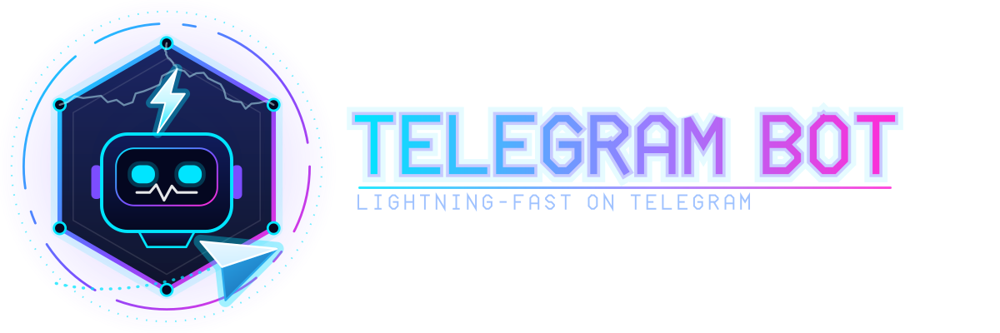</a><br><sub><code>logo-primary</code></sub></td><td align="center" valign="middle" width="25%"><a href="assets/09-static-svg/creator-badge.svg">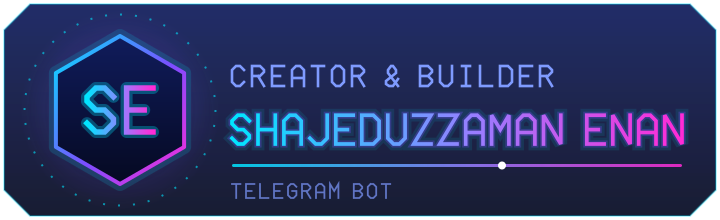</a><br><sub><code>creator-badge</code></sub></td><td align="center" valign="middle" width="25%"><a href="assets/09-static-svg/badge-available-on-telegram.svg"></a><br><sub><code>badge-available-on-telegram</code></sub></td><td align="center" valign="middle" width="25%"><a href="assets/09-static-svg/qr-frame-scan-to-open.svg"></a><br><sub><code>qr-frame-scan-to-open</code></sub></td></tr>
</table>

Non-animated versions for documentation, e-mail and print.

| Static SVG | Canvas | Weight | Animated counterpart |
|---|---|---|---|
| [`badge-available-on-telegram.svg`](assets/09-static-svg/badge-available-on-telegram.svg) | 560×112 | 6 KB | [`animated`](assets/15-telegram/badge-available-on-telegram.svg) |
| [`banner-github-1280x640.svg`](assets/09-static-svg/banner-github-1280x640.svg) | 1280×640 | 33 KB | [`animated`](assets/02-banners/banner-github-1280x640.svg) |
| [`banner-og-link-preview-1200x630.svg`](assets/09-static-svg/banner-og-link-preview-1200x630.svg) | 1200×630 | 33 KB | [`animated`](assets/02-banners/banner-og-link-preview-1200x630.svg) |
| [`banner-story-1080x1920.svg`](assets/09-static-svg/banner-story-1080x1920.svg) | 1080×1920 | 33 KB | [`animated`](assets/02-banners/banner-story-1080x1920.svg) |
| [`banner-x-header-1500x500.svg`](assets/09-static-svg/banner-x-header-1500x500.svg) | 1500×500 | 33 KB | [`animated`](assets/02-banners/banner-x-header-1500x500.svg) |
| [`bot-avatar-512.svg`](assets/09-static-svg/bot-avatar-512.svg) | 512×512 | 17 KB | [`animated`](assets/01-logo/bot-avatar-512.svg) |
| [`botfather-description-640x360.svg`](assets/09-static-svg/botfather-description-640x360.svg) | 640×360 | 32 KB | [`animated`](assets/02-banners/botfather-description-640x360.svg) |
| [`creator-badge.svg`](assets/09-static-svg/creator-badge.svg) | 720×220 | 9 KB | [`animated`](assets/12-creator/creator-badge.svg) |
| [`creator-credit-wide.svg`](assets/09-static-svg/creator-credit-wide.svg) | 1200×120 | 8 KB | [`animated`](assets/12-creator/creator-credit-wide.svg) |
| [`creator-monogram.svg`](assets/09-static-svg/creator-monogram.svg) | 512×512 | 5 KB | [`animated`](assets/12-creator/creator-monogram.svg) |
| [`logo-emblem.svg`](assets/09-static-svg/logo-emblem.svg) | 512×512 | 8 KB | [`animated`](assets/01-logo/logo-emblem.svg) |
| [`logo-primary.svg`](assets/09-static-svg/logo-primary.svg) | 1200×400 | 11 KB | [`animated`](assets/01-logo/logo-primary.svg) |
| [`logo-wordmark.svg`](assets/09-static-svg/logo-wordmark.svg) | 760×200 | 7 KB | [`animated`](assets/01-logo/logo-wordmark.svg) |
| [`paper-plane-glow.svg`](assets/09-static-svg/paper-plane-glow.svg) | 512×512 | 5 KB | [`animated`](assets/15-telegram/paper-plane-glow.svg) |
| [`qr-frame-scan-to-open.svg`](assets/09-static-svg/qr-frame-scan-to-open.svg) | 640×780 | 14 KB | [`animated`](assets/15-telegram/qr-frame-scan-to-open.svg) |
| [`watermark-built-by.svg`](assets/09-static-svg/watermark-built-by.svg) | 450×64 | 5 KB | [`animated`](assets/12-creator/watermark-built-by.svg) |

</details>

<details>
<summary><b>10 · Video</b> &nbsp;&mdash;&nbsp; 7 looping MP4 files</summary>

<br>

GitHub does not play repository MP4 files inline. Click a file to open it in GitHub's video viewer, or use the files directly in Telegram.

| Video | Spec | Loop | Weight | Use |
|---|---|---|---|---|
| [▶ `bot-avatar-animated-512.mp4`](assets/10-video/bot-avatar-animated-512.mp4) | H264 · 512×512 · 24 fps | 8.5 s | 1.6 MB | Animated avatar |
| [▶ `creator-badge-720x220.mp4`](assets/10-video/creator-badge-720x220.mp4) | H264 · 720×220 · 24 fps | 8.5 s | 572 KB | Animated creator badge |
| [▶ `status-error-512.mp4`](assets/10-video/status-error-512.mp4) | H264 · 512×512 · 24 fps | 4.2 s | 151 KB | Error status animation |
| [▶ `status-loading-512.mp4`](assets/10-video/status-loading-512.mp4) | H264 · 512×512 · 24 fps | 8.5 s | 420 KB | Loading status animation |
| [▶ `status-success-512.mp4`](assets/10-video/status-success-512.mp4) | H264 · 512×512 · 24 fps | 4.2 s | 121 KB | Success status animation |
| [▶ `thunderstorm-loop-1280x720.mp4`](assets/10-video/thunderstorm-loop-1280x720.mp4) | H264 · 1280×720 · 24 fps | 8.5 s | 5.3 MB | Ambient thunderstorm loop |
| [▶ `welcome-animation-1280x640.mp4`](assets/10-video/welcome-animation-1280x640.mp4) | H264 · 1280×640 · 24 fps | 8.5 s | 4.5 MB | Welcome animation: send with `sendAnimation` on `/start` |

</details>

<details>
<summary><b>11 · Starter bot</b> &nbsp;&mdash;&nbsp; 4 files</summary>

<br>

| File | Weight | Purpose |
|---|---|---|
| [`.env.example`](assets/11-starter-bot/.env.example) | 80 B | Environment template: `BOT_TOKEN`, `SUPPORT_URL` |
| [`README.md`](assets/11-starter-bot/README.md) | 419 B | Starter bot quick start |
| [`bot.py`](assets/11-starter-bot/bot.py) | 4 KB | aiogram 3 starter bot: `/start`, `/menu`, `/help`, `/profile`, `/premium`, `/about` |
| [`requirements.txt`](assets/11-starter-bot/requirements.txt) | 16 B | Dependency: `aiogram>=3.7,<4` |

```sh
cd assets/11-starter-bot
pip install -r requirements.txt
cp .env.example .env   # paste your BOT_TOKEN
python bot.py
```

Keep the folder inside `assets/`: the bot reads the menu images from `../13-menu-cards` and the welcome video from `../10-video`.

> [!NOTE]
> The starter bot is a minimal demo of the kit. It is a separate program from the Enan Ultra assistant, it was syntax-checked only and has not been run against Telegram.

</details>

<details>
<summary><b>12 · Creator</b> &nbsp;&mdash;&nbsp; 4 files</summary>

<br>

<table>
<tr><td align="center"><a href="assets/12-creator/creator-badge.svg"></a><br><sub><code>creator-badge</code></sub></td><td align="center"><a href="assets/12-creator/creator-monogram.svg"></a><br><sub><code>creator-monogram</code></sub></td></tr>
<tr><td colspan="2" align="center"><a href="assets/12-creator/creator-credit-wide.svg"></a><br><sub><code>creator-credit-wide</code></sub></td></tr>
<tr><td colspan="2" align="center"><a href="assets/12-creator/watermark-built-by.svg"></a><br><sub><code>watermark-built-by</code></sub></td></tr>
</table>

| File | Canvas | Use | Other formats |
|---|---|---|---|
| [`creator-badge.svg`](assets/12-creator/creator-badge.svg) | 720×220 | Creator and Builder badge | [`PNG`](assets/07-png-exports/creator/creator-badge-1440x440.png) · [`static SVG`](assets/09-static-svg/creator-badge.svg) · [`MP4`](assets/10-video/creator-badge-720x220.mp4) |
| [`creator-credit-wide.svg`](assets/12-creator/creator-credit-wide.svg) | 1200×120 | Wide credit line | [`PNG`](assets/07-png-exports/creator/creator-credit-wide-2400x240-transparent.png) · [`static SVG`](assets/09-static-svg/creator-credit-wide.svg) |
| [`creator-monogram.svg`](assets/12-creator/creator-monogram.svg) | 512×512 | Monogram | [`PNG`](assets/07-png-exports/creator/creator-monogram-1024-transparent.png) · [`static SVG`](assets/09-static-svg/creator-monogram.svg) · [`WebM sticker`](assets/06-stickers/video-webm/sticker-creator-monogram.webm) |
| [`watermark-built-by.svg`](assets/12-creator/watermark-built-by.svg) | 450×64 | "Built by" watermark for images and videos | [`PNG`](assets/07-png-exports/creator/watermark-built-by-transparent.png) · [`static SVG`](assets/09-static-svg/watermark-built-by.svg) |

</details>

<details>
<summary><b>13 · Menu cards</b> &nbsp;&mdash;&nbsp; 44 files (22 JPG and 22 SVG)</summary>

<br>

22 header images at 1280×720, each available as JPG (for Telegram `sendPhoto`) and animated SVG (for the web). The cards cover common bot screens; the plan, wallet, premium and referral cards are optional templates and do not describe features of the Enan Ultra assistant.

<table>
<tr><td align="center" width="50%"><a href="assets/13-menu-cards/card-welcome.svg"></a><br><sub><code>card-welcome</code> · <a href="assets/13-menu-cards/card-welcome.jpg">JPG</a> · <a href="assets/13-menu-cards/card-welcome.svg">SVG</a></sub></td><td align="center" width="50%"><a href="assets/13-menu-cards/card-menu.svg"></a><br><sub><code>card-menu</code> · <a href="assets/13-menu-cards/card-menu.jpg">JPG</a> · <a href="assets/13-menu-cards/card-menu.svg">SVG</a></sub></td></tr>
<tr><td align="center" width="50%"><a href="assets/13-menu-cards/card-profile.svg"></a><br><sub><code>card-profile</code> · <a href="assets/13-menu-cards/card-profile.jpg">JPG</a> · <a href="assets/13-menu-cards/card-profile.svg">SVG</a></sub></td><td align="center" width="50%"><a href="assets/13-menu-cards/card-premium.svg"></a><br><sub><code>card-premium</code> · <a href="assets/13-menu-cards/card-premium.jpg">JPG</a> · <a href="assets/13-menu-cards/card-premium.svg">SVG</a></sub></td></tr>
<tr><td align="center" width="50%"><a href="assets/13-menu-cards/card-stats.svg"></a><br><sub><code>card-stats</code> · <a href="assets/13-menu-cards/card-stats.jpg">JPG</a> · <a href="assets/13-menu-cards/card-stats.svg">SVG</a></sub></td><td align="center" width="50%"><a href="assets/13-menu-cards/card-settings.svg"></a><br><sub><code>card-settings</code> · <a href="assets/13-menu-cards/card-settings.jpg">JPG</a> · <a href="assets/13-menu-cards/card-settings.svg">SVG</a></sub></td></tr>
<tr><td align="center" width="50%"><a href="assets/13-menu-cards/card-language.svg"></a><br><sub><code>card-language</code> · <a href="assets/13-menu-cards/card-language.jpg">JPG</a> · <a href="assets/13-menu-cards/card-language.svg">SVG</a></sub></td><td align="center" width="50%"><a href="assets/13-menu-cards/card-support.svg"></a><br><sub><code>card-support</code> · <a href="assets/13-menu-cards/card-support.jpg">JPG</a> · <a href="assets/13-menu-cards/card-support.svg">SVG</a></sub></td></tr>
<tr><td align="center" width="50%"><a href="assets/13-menu-cards/card-help.svg"></a><br><sub><code>card-help</code> · <a href="assets/13-menu-cards/card-help.jpg">JPG</a> · <a href="assets/13-menu-cards/card-help.svg">SVG</a></sub></td><td align="center" width="50%"><a href="assets/13-menu-cards/card-wallet.svg"></a><br><sub><code>card-wallet</code> · <a href="assets/13-menu-cards/card-wallet.jpg">JPG</a> · <a href="assets/13-menu-cards/card-wallet.svg">SVG</a></sub></td></tr>
<tr><td align="center" width="50%"><a href="assets/13-menu-cards/card-admin.svg"></a><br><sub><code>card-admin</code> · <a href="assets/13-menu-cards/card-admin.jpg">JPG</a> · <a href="assets/13-menu-cards/card-admin.svg">SVG</a></sub></td><td align="center" width="50%"><a href="assets/13-menu-cards/card-broadcast.svg"></a><br><sub><code>card-broadcast</code> · <a href="assets/13-menu-cards/card-broadcast.jpg">JPG</a> · <a href="assets/13-menu-cards/card-broadcast.svg">SVG</a></sub></td></tr>
<tr><td align="center" width="50%"><a href="assets/13-menu-cards/card-success.svg"></a><br><sub><code>card-success</code> · <a href="assets/13-menu-cards/card-success.jpg">JPG</a> · <a href="assets/13-menu-cards/card-success.svg">SVG</a></sub></td><td align="center" width="50%"><a href="assets/13-menu-cards/card-error.svg"></a><br><sub><code>card-error</code> · <a href="assets/13-menu-cards/card-error.jpg">JPG</a> · <a href="assets/13-menu-cards/card-error.svg">SVG</a></sub></td></tr>
<tr><td align="center" width="50%"><a href="assets/13-menu-cards/card-maintenance.svg"></a><br><sub><code>card-maintenance</code> · <a href="assets/13-menu-cards/card-maintenance.jpg">JPG</a> · <a href="assets/13-menu-cards/card-maintenance.svg">SVG</a></sub></td><td align="center" width="50%"><a href="assets/13-menu-cards/card-about.svg"></a><br><sub><code>card-about</code> · <a href="assets/13-menu-cards/card-about.jpg">JPG</a> · <a href="assets/13-menu-cards/card-about.svg">SVG</a></sub></td></tr>
<tr><td align="center" width="50%"><a href="assets/13-menu-cards/card-plan-basic.svg"></a><br><sub><code>card-plan-basic</code> · <a href="assets/13-menu-cards/card-plan-basic.jpg">JPG</a> · <a href="assets/13-menu-cards/card-plan-basic.svg">SVG</a></sub></td><td align="center" width="50%"><a href="assets/13-menu-cards/card-plan-pro.svg"></a><br><sub><code>card-plan-pro</code> · <a href="assets/13-menu-cards/card-plan-pro.jpg">JPG</a> · <a href="assets/13-menu-cards/card-plan-pro.svg">SVG</a></sub></td></tr>
<tr><td align="center" width="50%"><a href="assets/13-menu-cards/card-plan-ultra.svg"></a><br><sub><code>card-plan-ultra</code> · <a href="assets/13-menu-cards/card-plan-ultra.jpg">JPG</a> · <a href="assets/13-menu-cards/card-plan-ultra.svg">SVG</a></sub></td><td align="center" width="50%"><a href="assets/13-menu-cards/card-channel.svg"></a><br><sub><code>card-channel</code> · <a href="assets/13-menu-cards/card-channel.jpg">JPG</a> · <a href="assets/13-menu-cards/card-channel.svg">SVG</a></sub></td></tr>
<tr><td align="center" width="50%"><a href="assets/13-menu-cards/card-community.svg"></a><br><sub><code>card-community</code> · <a href="assets/13-menu-cards/card-community.jpg">JPG</a> · <a href="assets/13-menu-cards/card-community.svg">SVG</a></sub></td><td align="center" width="50%"><a href="assets/13-menu-cards/card-referral.svg"></a><br><sub><code>card-referral</code> · <a href="assets/13-menu-cards/card-referral.jpg">JPG</a> · <a href="assets/13-menu-cards/card-referral.svg">SVG</a></sub></td></tr>
</table>

</details>

<details>
<summary><b>14 · Landing page</b> &nbsp;&mdash;&nbsp; 14 files</summary>

<br>

A single-page animated site built from the kit. Open [`index.html`](assets/14-landing-page/index.html) in a browser after replacing `YOUR_BOT_USERNAME`, or publish the folder with GitHub Pages.

| File | Weight | Referenced by index.html | Purpose |
|---|---|---|---|
| [`banner-og-link-preview-1200x630.png`](assets/14-landing-page/assets/banner-og-link-preview-1200x630.png) | 539 KB | yes | Open Graph image |
| [`bg-thunderstorm.png`](assets/14-landing-page/assets/bg-thunderstorm.png) | 893 KB | yes | Reduced-motion background |
| [`bg-thunderstorm.svg`](assets/14-landing-page/assets/bg-thunderstorm.svg) | 27 KB | yes | Animated thunderstorm background |
| [`button-open-in-telegram.svg`](assets/14-landing-page/assets/button-open-in-telegram.svg) | 7 KB | no | Bundled "Open in Telegram" button |
| [`creator-badge.svg`](assets/14-landing-page/assets/creator-badge.svg) | 10 KB | yes | Bundled creator badge |
| [`favicon-256.png`](assets/14-landing-page/assets/favicon-256.png) | 69 KB | yes | Favicon |
| [`icon-language.svg`](assets/14-landing-page/assets/icon-language.svg) | 4 KB | yes | Feature-card icon |
| [`icon-lock.svg`](assets/14-landing-page/assets/icon-lock.svg) | 4 KB | yes | Feature-card icon |
| [`icon-premium.svg`](assets/14-landing-page/assets/icon-premium.svg) | 4 KB | yes | Feature-card icon |
| [`icon-start.svg`](assets/14-landing-page/assets/icon-start.svg) | 4 KB | yes | Feature-card icon |
| [`icon-stats.svg`](assets/14-landing-page/assets/icon-stats.svg) | 4 KB | yes | Feature-card icon |
| [`icon-support.svg`](assets/14-landing-page/assets/icon-support.svg) | 4 KB | yes | Feature-card icon |
| [`logo-primary.svg`](assets/14-landing-page/assets/logo-primary.svg) | 14 KB | yes | Hero logo |
| [`index.html`](assets/14-landing-page/index.html) | 6 KB | yes | Animated landing page with feature cards, command list and credit footer |

> [!NOTE]
> The page loads Orbitron and Rajdhani from Google Fonts; self-host the fonts if you want no third-party requests. Its sample copy mentions premium and 24/7 support, so edit the text to match what you actually offer.

</details>

<details>
<summary><b>15 · Telegram identity</b> &nbsp;&mdash;&nbsp; 9 files</summary>

<br>

<table>
<tr><td align="center" valign="middle" width="33%"><a href="assets/15-telegram/buttons/button-contact-support.svg"></a><br><sub><code>button-contact-support</code></sub></td><td align="center" valign="middle" width="33%"><a href="assets/15-telegram/buttons/button-get-premium.svg"></a><br><sub><code>button-get-premium</code></sub></td><td align="center" valign="middle" width="33%"><a href="assets/15-telegram/buttons/button-join-channel.svg"></a><br><sub><code>button-join-channel</code></sub></td></tr>
<tr><td align="center" valign="middle" width="33%"><a href="assets/15-telegram/buttons/button-join-community.svg"></a><br><sub><code>button-join-community</code></sub></td><td align="center" valign="middle" width="33%"><a href="assets/15-telegram/buttons/button-open-in-telegram.svg"></a><br><sub><code>button-open-in-telegram</code></sub></td><td align="center" valign="middle" width="33%"><a href="assets/15-telegram/buttons/button-start-the-bot.svg"></a><br><sub><code>button-start-the-bot</code></sub></td></tr>
</table>

<table>
<tr><td align="center"><a href="assets/15-telegram/badge-available-on-telegram.svg"></a><br><sub><code>badge-available-on-telegram</code></sub></td><td align="center"><a href="assets/15-telegram/paper-plane-glow.svg"></a><br><sub><code>paper-plane-glow</code></sub></td><td align="center"><a href="assets/15-telegram/qr-frame-scan-to-open.svg"></a><br><sub><code>qr-frame-scan-to-open</code></sub></td></tr>
</table>

| Asset | Animated SVG | PNG export |
|---|---|---|
| `button-contact-support` | [`SVG`](assets/15-telegram/buttons/button-contact-support.svg) | [`PNG 640×120`](assets/07-png-exports/telegram/button-contact-support.png) |
| `button-get-premium` | [`SVG`](assets/15-telegram/buttons/button-get-premium.svg) | [`PNG 640×120`](assets/07-png-exports/telegram/button-get-premium.png) |
| `button-join-channel` | [`SVG`](assets/15-telegram/buttons/button-join-channel.svg) | [`PNG 640×120`](assets/07-png-exports/telegram/button-join-channel.png) |
| `button-join-community` | [`SVG`](assets/15-telegram/buttons/button-join-community.svg) | [`PNG 640×120`](assets/07-png-exports/telegram/button-join-community.png) |
| `button-open-in-telegram` | [`SVG`](assets/15-telegram/buttons/button-open-in-telegram.svg) | [`PNG 640×120`](assets/07-png-exports/telegram/button-open-in-telegram.png) |
| `button-start-the-bot` | [`SVG`](assets/15-telegram/buttons/button-start-the-bot.svg) | [`PNG 640×120`](assets/07-png-exports/telegram/button-start-the-bot.png) |
| `badge-available-on-telegram` | [`SVG`](assets/15-telegram/badge-available-on-telegram.svg) | [`PNG 1120×224`](assets/07-png-exports/telegram/badge-available-on-telegram.png) |
| `paper-plane-glow` | [`SVG`](assets/15-telegram/paper-plane-glow.svg) | [`PNG 1024×1024`](assets/07-png-exports/telegram/paper-plane-glow-1024-transparent.png) |
| `qr-frame-scan-to-open` | [`SVG`](assets/15-telegram/qr-frame-scan-to-open.svg) | [`PNG 640×780`](assets/07-png-exports/telegram/qr-frame-scan-to-open.png) |

The paper plane is an original motif, not the official Telegram logo. See [Independence and trademarks](#independence-and-trademarks).

</details>

<details>
<summary><b>Root files</b> &nbsp;&mdash;&nbsp; 4 files</summary>

<br>

| File | Weight | Purpose |
|---|---|---|
| [`README.md`](assets/README.md) | 4 KB | Original resource-pack README (inside, BotFather setup, notes) |
| [`preview.html`](assets/preview.html) | 28 KB | Open in a browser (after cloning or downloading) to see the animated assets |
| [`telegram-bot-banner-animated.svg`](assets/telegram-bot-banner-animated.svg) | 50 KB | Hero banner of this README |
| [`telegram-bot-button-open-in-telegram.svg`](assets/telegram-bot-button-open-in-telegram.svg) | 15 KB | Hero "Open in Telegram" button of this README |

</details>


### Integration playbook

How to apply the kit to a Telegram bot:

| Where | Use this file | Notes |
|---|---|---|
| BotFather `/setuserpic` | [`assets/07-png-exports/bot-avatar-512.png`](assets/07-png-exports/bot-avatar-512.png) | BotFather does not accept SVG, so upload the PNG export. |
| BotFather `/setdescriptionpic` | [`assets/07-png-exports/botfather-description-640x360.png`](assets/07-png-exports/botfather-description-640x360.png) | 640×360. |
| BotFather `/setabouttext` · `/setdescription` | [`assets/08-text-kit/botfather-texts-en-bn.md`](assets/08-text-kit/botfather-texts-en-bn.md) | English and Bangla texts (120 and 512 character limits). |
| BotFather `/setcommands` | [`assets/08-text-kit/botfather-commands.txt`](assets/08-text-kit/botfather-commands.txt) | A sample for the **starter bot**. Replace it with this bot's real command list from the [Command Reference](#command-reference) before registering. |
| Video stickers | [`assets/06-stickers/video-webm`](assets/06-stickers/video-webm) | In `@Stickers`, create a new video sticker pack and upload the `.webm` files. |
| Static stickers | [`assets/07-png-exports/stickers`](assets/07-png-exports/stickers) | 512×512, transparent. |
| Custom emoji | [`assets/07-png-exports/emoji-100`](assets/07-png-exports/emoji-100) | 100×100. |
| Welcome message | [`assets/10-video/welcome-animation-1280x640.mp4`](assets/10-video/welcome-animation-1280x640.mp4) | Send with `sendAnimation`. |
| Menus | [`assets/13-menu-cards`](assets/13-menu-cards) | Send `card-*.jpg` with `sendPhoto` plus the inline keyboards in [`keyboards.json`](assets/08-text-kit/keyboards.json). |
| Quick start | [`assets/11-starter-bot`](assets/11-starter-bot) | `pip install -r requirements.txt`, add `BOT_TOKEN` to `.env`, run `python bot.py`. |

### Independence and trademarks

Enan Ultra is an independent project. It is not affiliated with, endorsed by or sponsored by Telegram or by any provider named in this README. The paper plane in the kit is an original motif, not the official Telegram logo, which Telegram does not allow as a bot's own logo. For "Open in Telegram"-style buttons you may use Telegram's own downloadable logos, as long as it stays clear that the bot is independent.

<p align="center"></p>

<p align="center"></p>

<h2 align="center">Support</h2>

<p align="center"><i>Questions, bug reports and feedback.</i></p>


- **Bugs and questions:** [open a GitHub issue](https://github.com/shajeduzzamanenan992008inc/Telegram-Bot/issues). Include your Python version, whether you run locally or under systemd, and the relevant lines from `journalctl -u telegram-ai`. Never paste tokens or keys.
- **Product feedback:** use `/feedback good|bad [category]` in the bot.
- **Setup problems:** start with [`TROUBLESHOOTING`](docs/TROUBLESHOOTING.md), [`UPDATE_TROUBLESHOOTING`](docs/UPDATE_TROUBLESHOOTING.md) and [`STICKER_TROUBLESHOOTING`](docs/STICKER_TROUBLESHOOTING.md).
- **Security reports:** see [Reporting a vulnerability](#reporting-a-vulnerability).

<p align="center"></p>

<p align="center"></p>

<h2 align="center">License</h2>

<p align="center"><i>Source-available. The final terms are being finalized.</i></p>


> [!IMPORTANT]
> **Status: pending.** No final `LICENSE` file has been published at the repository root yet. The proposed terms below are drafted in [`docs/licensing-draft/`](docs/licensing-draft/) and are **not in force** until they are published as the project's license. Until then, please contact the copyright holder before reusing the code.

**Proposed model: Attribution-Required Non-Commercial Public Software License** (source-available, not an OSI-approved open-source license).

| | Proposed terms |
|---|---|
| ✅ **Non-commercial use** | Free to use, modify, fork, self-host and redistribute, **with attribution**. |
| 🔒 **Commercial use** | Only with separate written permission from the licensor, Shajeduzzaman Enan. |
| 🚫 **AI and ML training** | Prohibited without separate written permission. |
| 📎 **Scope** | Third-party software, provider terms and user data are outside the license; see the drafts. |

Copyright holder and licensor: **Shajeduzzaman Enan**.

<p align="center"></p>

<p align="center"></p>

<h2 align="center">Credits</h2>

<p align="center"><i>Designed and built by Shajeduzzaman Enan.</i></p>


<p align="center">
  
</p>

<p align="center"><b>Creator and Builder: <a href="https://github.com/shajeduzzamanenan992008inc">Shajeduzzaman Enan</a></b></p>

**Built on excellent technology.** The [Telegram Bot API](https://core.telegram.org/bots/api), [OpenRouter](https://openrouter.ai), [Groq](https://groq.com), [Google Gemini](https://ai.google.dev), [Cloudflare Workers AI](https://developers.cloudflare.com/workers-ai/), [Hugging Face](https://huggingface.co), [Ollama](https://ollama.com), [DuckDuckGo](https://duckduckgo.com), [Home Assistant](https://www.home-assistant.io), [ClamAV](https://www.clamav.net), [Tesseract](https://github.com/tesseract-ocr/tesseract), [FFmpeg](https://ffmpeg.org), [Poppler](https://poppler.freedesktop.org), [SQLite](https://www.sqlite.org), [rootless Docker](https://docs.docker.com/engine/security/rootless/), [uv](https://docs.astral.sh/uv/), [aiogram](https://aiogram.dev) (starter bot only) and the [Orbitron](https://fonts.google.com/specimen/Orbitron) and [Rajdhani](https://fonts.google.com/specimen/Rajdhani) typefaces.

<p align="center"></p>

<div align="center">


<sub>Built with ⚡ by <b>Shajeduzzaman Enan</b></sub>

<a href="#readme-top"><b>↑ Back to top</b></a>

</div>
