# AI provider routing architecture

The bot routes chat requests through the configured provider adapters. The router checks privacy mode, model availability, declared capabilities, free-model policy, estimated cost, a per-request attempt budget, and provider circuit state before sending a request.

```mermaid
flowchart LR
    A([Telegram request]) e1@--> B{Privacy mode}
    B e2@-->|Local only| C[(Ollama only)]
    B e3@-->|Cloud allowed| D([Primary model])
    D e4@--> E[AI_PROVIDER_ORDER]
    E e5@--> F{Capability and free/cost policy}
    F e6@--> G[Attempt budget and circuit breaker]
    G e7@--> H[[Provider adapter]]
    H e8@-->|Success| I([AssistantResult])
    H e9@-->|Temporary failure| J[Eligible next model/provider]
    J e10@--> F

    classDef entry fill:#102A43,stroke:#38BDF8,color:#F0F9FF,stroke-width:2.5px
    classDef decision fill:#3B2F63,stroke:#C4B5FD,color:#F5F3FF,stroke-width:2.5px
    classDef local fill:#123B36,stroke:#34D399,color:#ECFDF5,stroke-width:2px
    classDef cloud fill:#12345A,stroke:#60A5FA,color:#EFF6FF,stroke-width:2px
    classDef policy fill:#3F3218,stroke:#FBBF24,color:#FFFBEB,stroke-width:2px
    classDef provider fill:#123B4A,stroke:#22D3EE,color:#ECFEFF,stroke-width:2.5px
    classDef success fill:#123D2B,stroke:#4ADE80,color:#F0FDF4,stroke-width:2.5px
    classDef retry fill:#492817,stroke:#FB923C,color:#FFF7ED,stroke-width:2px

    class A entry
    class B,F decision
    class C local
    class D,E,G cloud
    class H provider
    class I success
    class J retry

    class e1,e3,e4,e5,e6,e7,e8 cloudFlow
    class e2 localFlow
    class e9,e10 retryFlow

    classDef cloudFlow stroke:#60A5FA,stroke-width:2.5px,stroke-dasharray:9\,5,animation:fast
    classDef localFlow stroke:#34D399,stroke-width:2.5px
    classDef retryFlow stroke:#FB923C,stroke-width:2.5px,stroke-dasharray:7\,5,animation:fast
```

## Supported providers

The configured cloud router supports OpenRouter, Groq, Gemini, Cloudflare Workers AI, and Hugging Face Inference Providers. The order defaults to `openrouter,groq,gemini,cloudflare,huggingface`; `AI_PROVIDER_ORDER` changes that order. A provider must also have its credentials, endpoint/account details, and model configured before it can be selected. Local Ollama is an optional route and is used by local-only privacy mode.

OpenRouter also supplies model catalog, pricing, web search, and media/file operations. The other four chat adapters use their provider APIs directly. Direct provider credentials and OpenRouter credentials are independent; routing through Hugging Face or OpenRouter does not make the bot's local cost estimate equivalent to the provider's invoice.

## Model eligibility and capabilities

- `/model provider::model-id` selects a preferred model. Unqualified IDs refer to OpenRouter.
- A model must accept the requested input modality. Tool use, image input, and streaming require provider catalog evidence or an explicit qualified-model setting (`AI_TOOL_CAPABLE_MODELS`, `AI_IMAGE_CAPABLE_MODELS`, `AI_STREAMING_MODELS`).
- OpenRouter catalog capability and price data can change. Direct adapters only claim optional capabilities that an operator explicitly lists.
- In `AI_FREE_ONLY=true` mode, only models in `AI_FREE_MODEL_ALLOWLIST` are eligible for cloud routing. Each entry is `provider::model-id`. Local Ollama remains available in local-only mode.
- `AI_ALLOW_PAID_FALLBACK=true` permits non-allowlisted candidates only when the configured estimated-cost cap is positive and the candidate has an acceptable estimate. Unknown price is not approved for paid fallback.

## Request metadata and privacy

Successful chat results include provider, model, elapsed time, and a generated correlation ID. Logs and admin failure alerts contain provider/category/correlation metadata, not prompts, completions, or credential values. `/providerdiag` reads local circuit and credential-health state without probing providers. `/providers` performs the provider's cached health probe; `/providerdiag recheck <provider>` explicitly runs a fresh model-list check.

The key health file beside `DATABASE_PATH` stores only SHA-256 fingerprints of rejected credential values. It allows rejected keys to remain quarantined after restart without writing the keys themselves. Protect this state file like other application state.

See [provider setup](PROVIDER_SETUP.md), [retry and failover](FAILOVER_AND_RETRY.md), and [free-tier and cost controls](FREE_TIER_AND_COST_CONTROL.md).
